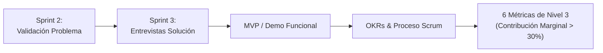

# 📋 Informe Ejecutivo — Requisitos y Plan de Acción: Sprint 3 (Nivel 3)
> **Cátedra:** Emprendimientos Tecnológicos — UTN FRC  
> **Metodología:** ExO Launchpad / Lean Startup  
> **Foco del Sprint:** Validación de la Solución, Construcción de Producto y Viabilidad Económica.

---

## 🎯 Objetivo General del Sprint 3
Pasar de la **Validación del Problema (Sprint 2)** a la **Validación de la Solución (Sprint 3)** con usuarios y clientes reales. Se debe construir/ajustar el prototipo de producto (MVP), formalizar el proceso de desarrollo de software, establecer los OKRs del equipo y demostrar tracción inicial de viabilidad económica.



---

## 📌 1. Checklist de Actividades Obligatorias a Desarrollar

| # | Actividad | Descripción y Alcance | Entregable Esperado |
|---|---|---|---|
| **1** | **Definir / Ajustar Valores** | Formalizar los valores nucleares del equipo/organización que guían las decisiones y la cultura de trabajo. | Sección de Valores en Canvas de Cultura / Presentación. |
| **2** | **Entrevistas de Solución (5 a 10)** | Salir a la cancha a testear la demo o prototipo con prospectos calificados. Evaluar si la propuesta resuelve el dolor y si pagarían/usarían el servicio. | Guion de entrevista de solución + Matriz de respuestas y aprendizajes. |
| **3** | **Revisión y Ajuste de la Demo/MVP** | Iterar el prototipo en función directa del feedback recibido en las entrevistas de solución (pivotes o mejoras de UX). | Demo interactiva / Wireframes actualizados (en nuestro caso: bot de WhatsApp + buscador stock express). |
| **4** | **Definición y Gestión de OKRs** | Fijar **3 a 4 OKRs organizacionales** para el próximo trimestre (próximos 3 meses) para alinear objetivos ambiciosos con resultados medibles. | Matriz trimestral de OKRs (Objetivos cualitativos + Key Results cuantificables). |
| **5** | **Proceso de Construcción de Producto** | Diseñar el proceso formal de desarrollo de software para el equipo (Scrum / Kanban, ceremonias, definición de releases, control de versiones). | Diagrama o documento del flujo ágil de construcción del producto. |
| **6** | **Cumplimiento de las 6 Métricas de Nivel 3** | Alcanzar y documentar con evidencia los valores de corte exigidos por la cátedra para aprobar el Nivel 3. | Dashboard / lámina de métricas validadas con números reales. |

---

## 📊 2. Las 6 Métricas Críticas de Nivel 3 (Validación de Solución)

Para certificar el Sprint 3, la cátedra evalúa rigurosamente el cumplimiento de estos 6 indicadores:

```
┌─────────────────────────────────────────────────────────────────────────────┐
│                       6 MÉTRICAS OBLIGATORIAS - NIVEL 3                     │
├─────────────────────────────────────────────────────────────────────────────┤
│ 1. Perfil Early Adopters   │ Segmento inicial bien acotado y caracterizado. │
│ 2. Problema Validado       │ Mínimo 10 prospectos con el dolor comprobado.  │
│ 3. Funcionalidades Mínimas │ Alcance funcional del MVP estrictamente acotado│
│ 4. Modelo de Monetización  │ Mecanismo de ingresos formalmente definido.    │
│ 5. Tracción Comercial      │ Mínimo 10 clientes dispuestos a pagar/adherir. │
│ 6. Viabilidad Financiera   │ Contribución Marginal Positiva (> 30%).        │
└─────────────────────────────────────────────────────────────────────────────┘
```

### Detalle de cada Métrica:
1. **Perfil de Early Adopter:**  
   - *Definición:* Describir al milímetro quién es el primer usuario que adoptará la solución antes que la masa.  
   - *En FarmaLink:* Pacientes polimedicados o con recetas crónicas y farmacias barriales independientes saturadas de mensajes fuera de hora.
2. **Problema Validado en al menos 10 Prospectos:**  
   - *Evidencia:* Se hereda y consolida del Sprint 2 (15 pacientes y 5 farmacias relevadas que confirmaron el dolor de stock y colas).
3. **Definición de Funcionalidades Mínimas (Scope del MVP):**  
   - *Alcance:* No sobre-diseñar. Limitar a lo indispensable para entregar valor inmediato:  
     - Validación de receta/obra social y stock prioritario (Click & Collect).  
     - Bot inteligente en WhatsApp para farmacias que filtra pedidos y audios sin obligar a usar otra web.
4. **Modelo de Monetización Determinado:**  
   - Modelo validado: **B2B freemium para farmacias** (barrera cero de adopción) monetizado mediante **publicidad programática y patrocinios de laboratorios / marcas OTC**, o comisión por transacción de delivery prioritario.
5. **Al menos 10 Clientes Dispuestos a Pagar / Adherir a la Solución:**  
   - *Requisito:* Presentar cartas de intención (LOI), reservas, compromisos firmados o pre-suscripciones donde 10 prospectos validen que usarán/pagarán por el servicio.
6. **Negocio Económicamente Viable (Contribución Marginal):**  
   - Debe calcularse la **Contribución Marginal (CM)** sobre la unidad vendida/transaccionada:
     $$\text{Contribución Marginal} = \text{Precio de Venta / Facturación} - \text{Costos Variables Directos}$$
     $$\%\text{ Contribución Marginal} = \frac{\text{Contribución Marginal}}{\text{Precio de Venta}} \times 100 \ge 30\%$$
   - Debe ser holgadamente positiva para garantizar que cada transacción ayude a cubrir los costos fijos de servidores, desarrollo y marketing.

---

## 🎯 3. Formulación de OKRs para el Próximo Trimestre (Guía Práctica)

El video destaca que los OKRs deben ser **ambiciosos pero alcanzables (nivel de éxito en ~70%)**, no simples tareas rutinarias:

* **Objetivo (Cualitativo):** Hacia dónde vamos (inspirador y ambicioso).
* **Key Results (Cuantitativos):** Cómo medimos si llegamos (3 a 4 resultados clave numéricos por objetivo).

### Ejemplo Propuesto para FarmaLink (Q1):
* **OKR 1 (Validación de Producto):** Lograr una adopción fluida del MVP en las farmacias de prueba.
  * *KR 1.1:* Conectar 10 farmacias barriales piloto al bot de WhatsApp.
  * *KR 1.2:* Procesar al menos 150 pedidos de Click & Collect exitosos en el primer mes.
  * *KR 1.3:* Mantener un Net Promoter Score (NPS) $> 60$ tanto en pacientes como en farmacias.
* **OKR 2 (Viabilidad y Monetización):** Validar la tasa de conversión y el interés comercial de anunciantes.
  * *KR 2.1:* Conseguir 2 pre-acuerdos de sponsoreo con laboratorios o marcas OTC.
  * *KR 2.2:* Demostrar una contribución marginal superior al 35% por transacción asistida.
* **OKR 3 (Excelencia Operativa & Software):** Asegurar una arquitectura estable y tiempos de respuesta inmediatos.
  * *KR 3.1:* Lograr tiempo de respuesta del bot $< 3$ segundos en el 95% de las interacciones.
  * *KR 3.2:* Ejecutar sprints quincenales cumpliendo con al menos el 85% de los story points comprometidos.

---

## 🛠️ 4. Proceso de Desarrollo de Software (Framework Ágil)

Se debe diagramar y documentar:
1. **Roles:** Product Owner (priorización backlog según entrevistas), Scrum Master (ritmo y bloqueos), Development Team.
2. **Ceremonias:**
   - *Sprint Planning:* Selección de User Stories del MVP.
   - *Daily Standups:* 15 minutos (¿Qué hice? ¿Qué haré? ¿Qué bloqueos tengo?).
   - *Sprint Review & Demo:* Presentación de incrementos funcionales con usuarios reales.
   - *Sprint Retrospective:* Ajuste continuo del equipo.
3. **Flujo de Trabajo:** Tablero Kanban (Backlog $\to$ Ready $\to$ In Progress $\to$ Code Review $\to$ Testing $\to$ Done).

---

## 🚀 Próximos Pasos Inmediatos para FarmaLink
1. Diseñar el **guion de 5 a 6 preguntas de la Entrevista de Solución** (mostrando capturas/flujo de Figma del bot y Click & Collect).
2. Ejecutar **5 a 10 entrevistas** para conseguir la validación de la solución y los **10 compromisos de adopción**.
3. Redactar la **hoja de cálculo de Contribución Marginal** (Ingresos vs. Costos de servidores/APIs WhatsApp Twilio).
4. Volcar todo en la lámina oficial de Sprint 3.
