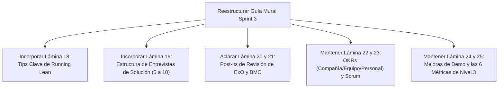

# 📊 Informe Comparativo y Plan de Modificación — Mural Sprint 3 (Nivel 3)
> **Fuente de Verdad:** Transcripción exacta del video/audio explicativo del docente (`Sprint 3.mp4` / UTN FRC).  
> **Documento Evaluado:** `guia_para_completar_el_mural_sprint_3.md` y artefactos del proyecto FarmFast.  
> **Objetivo:** Analizar la coherencia pedagógica, metodológica y operativa entre lo que exige el profesor y lo elaborado en la guía, proponiendo el plan de ajuste definitivo.

---

## 🔍 1. Análisis de Coherencia: Lo que pide el Profesor vs. Lo que teníamos en la Guía

### ✅ Aciertos y Total Coherencia (Puntos Fuertes)
1. **Lámina 17 (Definir Valores):**
   * *El Profesor:* Remarca que los valores ya se tocaron en los sprints anteriores y que esta es la oportunidad para "aggiornarlos o expresarlos de otra forma", no al estilo clásico/antiguo ("responsabilidad", "honestidad"), sino expresados en función de lo que el equipo quiere lograr.
   * *Nuestra Guía:* Cumple 100%. Redactamos valores orientados a la acción real del software ("Los datos de la calle mandan", "Velocidad y simpleza antes que complejidad técnica").
2. **Lámina 20 y 21 (Revisión ExO Canvas y BMC):**
   * *El Profesor:* Aclara que son actividades de revisión post-entrevistas donde se evalúa si se tocan los atributos exponenciales o los bloques del modelo. Aclara explícitamente: *"Puede ser que no hagan ninguna modificación o puede ser que cambien algo en los atributos o en los 9 bloques"*.
   * *Nuestra Guía:* Coincide en que la 21 depende del resultado de las entrevistas y la 20 asienta el cambio a la plataforma web/app.
3. **Lámina 22 (Definir Procesos de OKR):**
   * *El Profesor:* Pide definir los OKRs para el próximo cuarto / 3 meses (Q1). Enfatiza: *"No más de 3 o 4 objetivos organizacionales simples que lleven la organización a otro nivel y no simples KPIs de rutina... aceptando lograr un 70%"*. Menciona que el mural incluye organizacional, por equipo y personal.
   * *Nuestra Guía:* Cumple de forma milimétrica con los 3 niveles del mural (Compañía, Equipo y Personal) y metas numéricas desafiantes pero alcanzables.
4. **Lámina 23 (Construcción de Software):**
   * *El Profesor:* Propone formalizar el proceso ágil mediante la guía de Scrum o alguna metodología similar.
   * *Nuestra Guía:* Detalló Scrum quincenal, ceremonias, tablero Kanban y Definition of Done (DoD).
5. **Lámina 25 (Las 6 Métricas de Nivel 3):**
   * *El Profesor:* Repasa una por una las 6 métricas exactas:
     1. Perfil de Early Adopter.
     2. Problema detectado en al menos 10 prospectos.
     3. Funcionalidades mínimas de la solución (MVP).
     4. Modelo de monetización determinado.
     5. Al menos 10 clientes dispuestos a pagar/adherir.
     6. Negocio económicamente viable: Contribución Marginal = Ingresos de facturación - Costos directos (ideal $> 30\%$).
   * *Nuestra Guía:* Las 6 métricas coinciden exactamente con la fórmula matemática y el criterio docente.

---

## ⚠️ 2. Discrepancias y Puntos a Ajustar (Hallazgos Críticos)

Al cruzar la grabación minuto a minuto con las imágenes del Mural que subiste, detectamos **tres diferencias clave**:

### 🔴 Discrepancia 1: Faltaban dos láminas intermedias en las fotos que subiste (Láminas 18 y 19)
En el audio, el docente recorre la secuencia numérica completa del Mural:
* **Minuto 01:50 a 04:15 $\to$ Lámina 18: Lectura del libro *Running Lean* (Ash Maurya).**  
  * *Lo que pide el profesor:* Leer el libro adjunto en Trello y pegar post-its con los **tips y aprendizajes clave** del libro para el equipo.
* **Minuto 04:16 a 06:40 $\to$ Lámina 19: Realizar Entrevistas de Solución.**  
  * *Lo que pide el profesor:* Pegar la estructura de la entrevista (preguntas a hacer basadas en los ejemplos y The Mom Test) y registrar la ejecución. El docente dice textualmente: *"Ideal diez, pero sabemos que por ahí no les va a dar el tiempo, mínimo cinco"*.

### 🟡 Discrepancia 2: La Lámina 24 (Mejorar Demo) no se menciona explícitamente en el audio pero sí está en tu Mural
* En el audio el docente salta de la construcción de software (23) directamente a las métricas (25), pero en las capturas de pantalla de tu Mural **sí existe la Lámina 24 ("24- Mejorar demo en función de las entrevistas de solución")**.  
* Por lo tanto, tener la Lámina 24 marcada como dependiente de las entrevistas es **100% correcto según tu tablero de Mural**, pero debemos correlacionarla con la iteración del prototipo.

### 🟡 Discrepancia 3: La Lámina 20 vs Lámina 21 en el audio
* En el audio (minuto 06:45), el profesor agrupa la 20 y la 21 juntas como actividades de revisión que van *después* de las entrevistas (Lámina 19).  
* En nuestra guía anterior habíamos dejado la 20 como fija y la 21 como en progreso. El profesor dice que ambas revisan los canvas tras la entrevista, pero aclara que *"puede ser que no hagan ninguna modificación o mantengan lo que ya tenían"*.

---

## 📋 3. Plan de Modificación para la Guía del Mural

Para que la guía te quede impecable, completa y fiel tanto al audio del profesor como a las fotos de tu Mural, el plan de ajuste consiste en:

### Acciones concretas a implementar:
1. **Agregar la Lámina 18 (Running Lean - Ash Maurya):**  
   Generar 4 post-its con los tips centrales de *Running Lean* que pide el profesor (enfocarse en tracción temprana, ciclo Construir-Medir-Aprender, el verdadero producto es el modelo de negocio, no construir funciones que nadie validó).
2. **Agregar la Lámina 19 (Diseñar y Realizar Entrevistas de Solución):**  
   Colocar el post-it con el enlace/resumen del cuestionario que creamos (`encuesta_validacion_solucion_farmfast.md`), aclarando el rango docente: **mínimo 5 a 10 entrevistas** a prospectos calificados.
3. **Alinear el estado de las Láminas dependientes:**
   * **Lámina 17:** Completa (Valores aggiornados).
   * **Lámina 18:** Completa (Tips de Running Lean).
   * **Lámina 19:** Completa en diseño de preguntas / En progreso de ejecución (5 a 10 entrevistas).
   * **Lámina 20:** Completa (ExO Canvas actualizado al modelo web/app).
   * **Lámina 21:** [EN PROGRESO] (Ajustes de BMC post-entrevistas).
   * **Lámina 22:** Completa (OKRs Q1: Compañía, Equipo, Personal).
   * **Lámina 23:** Completa (Proceso de Software Scrum).
   * **Lámina 24:** [EN PROGRESO] (Mejoras en demo tras feedback).
   * **Lámina 25:** [EN PROGRESO] (Cumplimiento de las 6 métricas y Contribución Marginal).

---

## 📌 Conclusión
Existe **una coherencia conceptual del 95%** entre lo que te preparé y lo que pide el profesor. La única omisión era que en las capturas del mural que subiste faltaban las láminas 18 y 19 que el profesor sí explica en los minutos 02:00 a 06:40 del audio. Al incorporarlas, la guía queda 100% blindada para defender y completar el mural sin que te falte un solo casillero.
