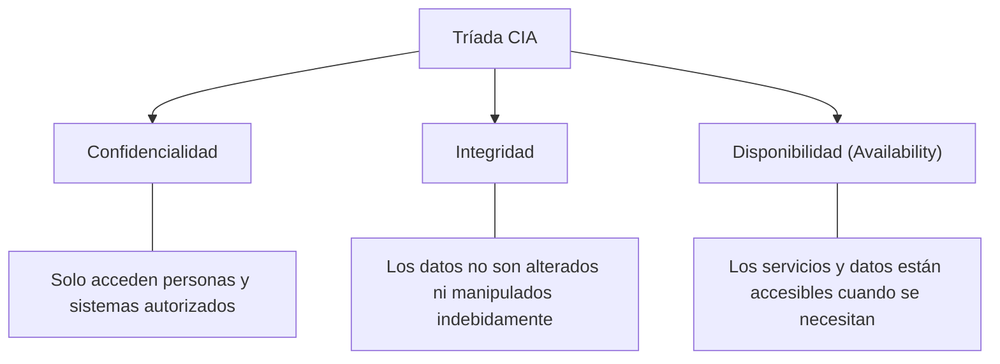
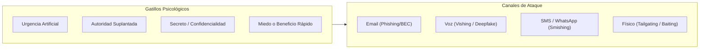
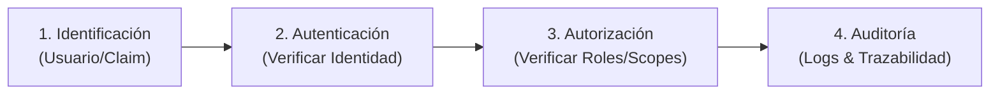
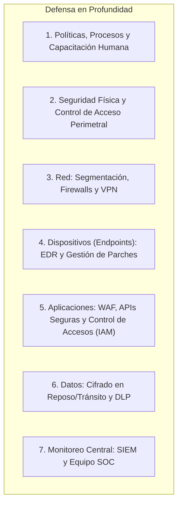
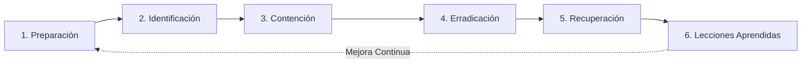

# Conceptos Generales de Ciberseguridad, Identidad y Defensa en Profundidad

**Rama:** [[Hub_IAEW|IAEW]]  
**Tags:** #materia/iaew #seguridad #ciberseguridad #cia #iam #mfa #fido2 #edr #siem #ransomware #parcial  
**Fecha:** 2026-10-15  
**Categoría:** Seguridad de la Información y Gestión de Riesgos  

---

## 🧭 Índice de Contenidos

1. [[#1. Fundamentos de Seguridad y la Tríada CIA|Fundamentos y la Tríada CIA]]
2. [[#2. Ecuación de Riesgo: Activo, Amenaza, Vulnerabilidad y Control|Ecuación de Riesgo]]
3. [[#3. El Vector Humano: Ingeniería Social y Ataques Modernos|Ingeniería Social y Amenazas Modernas]]
4. [[#4. Gestión de Identidad y Acceso (IAM) y MFA Resistente|Gestión de Identidad (IAM) y MFA]]
5. [[#5. Ransomware, Fuga de Datos (DLP) y Continuidad Operativa|Ransomware, Fuga de Datos y Continuidad]]
6. [[#6. Defensa en Profundidad: EDR, SIEM y Monitoreo Activo|Defensa en Profundidad: EDR vs. SIEM]]
7. [[#7. Ciclo de Respuesta a Incidentes (NIST SP 800-61)|Ciclo de Respuesta a Incidentes]]
8. [[#8. Biometría y Análisis de Casos de Estudio 2026|Biometría y Casos Modernos 2026]]
9. [[#9. Banco de Preguntas y Mini-Evaluaciones de Examen|Banco de Preguntas para el Parcial]]

---

## 🛡️ 1. Fundamentos de Seguridad y la Tríada CIA

La ciberseguridad tiene como propósito proteger los activos de información, sistemas tecnológicos, procesos y personas frente a accesos no autorizados, alteraciones maliciosas e interrupciones del servicio.



### Casos de Estudio de la Tríada:
* **Fallo de Integridad:** Una aplicación bancaria funciona con fluidez (alta disponibilidad), pero en la pantalla muestra saldos incorrectos o transacciones alteradas. El problema principal es de **Integridad**.
* **Fallo de Disponibilidad:** Una tienda de e-commerce sufre un ataque de denegación de servicio (DDoS) o un colapso de base de datos y la página deja de responder. Afecta la **Disponibilidad**.
* **Fallo de Confidencialidad:** Un archivo de base de datos con números de tarjetas de crédito se filtra en un repositorio público de GitHub o en un bucket S3 mal configurado. Afecta la **Confidencialidad**.

---

## ⚖️ 2. Ecuación de Riesgo: Activo, Amenaza, Vulnerabilidad y Control

Para gestionar la seguridad se utiliza una distinción conceptual rigurosa:

$$\text{Riesgo} = \text{Probabilidad de Ocurrencia (Amenaza} \times \text{Vulnerabilidad)} \times \text{Impacto sobre el Activo}$$

* **Activo (*Asset*):** Aquello que tiene valor para la organización y debe protegerse (datos de clientes, código fuente, servidores, reputación, infraestructura).
* **Vulnerabilidad:** Una debilidad interna, fallo de configuración, falta de actualización o brecha de diseño en un sistema o proceso (ej. un servidor Linux con versión desactualizada de OpenSSL sin parchar).
* **Amenaza:** Una causa potencial de daño externa o interna (ej. un grupo cibercriminal escaneando puertos en Internet buscando software desactualizado).
* **Impacto:** Magnitud del perjuicio ocasionado en caso de que la amenaza explote con éxito la vulnerabilidad (pérdida económica, multas legales, caída operativa).
* **Control:** Medida preventiva, detectiva o correctiva implementada para mitigar el riesgo (ej. firewall, MFA, WAF, gestión de parches).
* **Incidente:** Evento confirmado que compromete o amenaza la confidencialidad, integridad o disponibilidad de un sistema o información.

> [!WARNING]
> **Vulnerabilidad $\neq$ Incidente:**  
> Tener un software sin actualizar es una **vulnerabilidad**. Un atacante que aprovecha esa falla para entrar a la red y extraer información es un **incidente**.

---

## 🎣 3. El Vector Humano: Ingeniería Social y Ataques Modernos

La ingeniería social consiste en la manipulación psicológica de personas para inducirlas a entregar credenciales, divulgar información sensible o ejecutar acciones que comprometan la seguridad.



### 3.1. Taxonomía de Ataques de Ingeniería Social

| Tipo de Ataque | Mecanismo y Características | Ejemplo Real / Hipotético |
| :--- | :--- | :--- |
| **Phishing** | Correo electrónico masivo y genérico suplantando a entidades conocidas (bancos, correo postal). | Mail simulando ser Correo Argentino exigiendo pago de aduana con link a sitio falso. |
| **Spear-Phishing** | Correo dirigido y personalizado a una persona u organización específica con información previa de la víctima. | Correo dirigido al responsable de compras mencionando un proyecto real de la empresa para que abra un Excel infectado. |
| **Whaling** | Spear-phishing de alto nivel dirigido exclusivamente a ejecutivos, directores o funcionarios (*peces gordos*). | Correo al CEO simulando una citación judicial de urgencia. |
| **BEC (*Business Email Compromise*)** | Fraude por compromiso o suplantación del correo corporativo. No busca instalar malware, sino desviar pagos o transferencias. | Un proveedor habitual sufre el robo de su cuenta de mail. El atacante escribe desde la cuenta real pidiendo actualizar con urgencia su CBU bancario para el cobro de facturas. |
| **Vishing (*Voice Phishing*)** | Llamadas telefónicas suplantando soporte técnico, bancos o autoridades. | Falso operador de soporte que llama pidiendo que el usuario "apruebe la notificación en su app de autenticación". |
| **Smishing** | Mensajes de texto SMS o WhatsApp con enlaces maliciosos. | Mensaje SMS avisando sobre una "suspensión inminente de la cuenta bancaria". |
| **Pretexting** | Creación de un escenario o historia ficticia elaborada para ganarse la confianza de la víctima y solicitar información. | Atacante que se hace pasar por un auditor externo realizando un relevamiento urgente de procesos de liquidación. |
| **Baiting (Señuelo)** | Promesa de un beneficio o curiosidad física/digital. | Dejar un pendrive USB abandonado con la etiqueta *"Sueldos Directivos 2026"* en el estacionamiento de la empresa para que alguien lo conecte. |
| **Quid Pro Quo** | Ofrecer un servicio o beneficio a cambio de información. | Llamar fingiendo ser de soporte técnico prometiendo mejorar la velocidad de la máquina a cambio de su clave. |
| **Tailgating (Piggybacking)** | Ataque físico donde una persona sin credencial sigue de cerca a un empleado autorizado para ingresar a un edificio. | Individuo con cajas en las manos que pide amablemente que le sostengan la puerta de acceso magnética. |
| **Watering-Hole** | Infección de un sitio web legítimo altamente frecuentado por el grupo objetivo (ej. foro de profesionales o proveedor local). | Los empleados visitan el sitio de viandas local y sus navegadores se infectan con un exploit. |
| **Deepfakes y Clonación de Voz** | Uso de inteligencia artificial generativa para clonar audio o video de directivos o familiares. | Llamada de audio idéntica a la voz del Gerente General ordenando transferir fondos fuera de horario por una supuesta oportunidad de adquisición. |

> [!IMPORTANT]
> **Regla de Oro ante Cambios de CBU o Solicitudes Urgentes:**  
> **Verificación Fuera de Banda (*Out-of-Band Verification*):** Si se recibe una orden de pago o un cambio de cuenta bancaria por correo o mensajería, **jamás responder a ese mismo correo ni usar los teléfonos listados en el mensaje**. Se debe llamar al número oficial previamente registrado del proveedor o utilizar doble circuito de aprobación.

---

## 🔑 4. Gestión de Identidad y Acceso (IAM) y MFA Resistente

La seguridad de acceso descansa sobre cuatro pilares:
1. **Identificación:** Declarar una identidad (*"Soy usuario `msizarra"`"*).
2. **Autenticación:** Demostrar que dicha identidad es verídica (*"Aquí está mi contraseña y mi llave FIDO2"*).
3. **Autorización:** Comprobar si esa identidad autenticada tiene permisos para ejecutar una acción sobre un recurso (*"¿El rol `auditor` puede modificar pedidos? NO (403 Forbidden)"*).
4. **Auditoría / Trazabilidad:** Registrar quién hizo qué, cuándo y desde dónde en bitácoras inmutables.



### 4.1. Principio de Mínimo Privilegio (*Least Privilege*)
Cada usuario, aplicación o proceso debe contar **únicamente con los permisos estrictamente necesarios** para desempeñar su función, durante el tiempo mínimo indispensable. Estar autenticado en una aplicación no otorga derecho a ver la totalidad de los datos.

### 4.2. Evolución del MFA: Del SMS al MFA Resistente al Phishing
* **Factores Clásicos:**
  * Algo que sabés (contraseña, PIN).
  * Algo que tenés (celular, token físico, tarjeta inteligente).
  * Algo que sos (huella dactilar, biometría facial).
* **Vulnerabilidades del MFA Débil (SMS / TOTP / Notificaciones Push):**
  * **Intercepción y SIM Swapping:** Los SMS son interceptables en la red celular.
  * **MFA Prompt Bombing (Fatiga de MFA):** Atacantes disparan decenas de notificaciones push de madrugada hasta que el usuario, cansado o confundido, presiona "Aprobar".
  * **Reverse Proxy Phishing (Evilginx):** El atacante intercepta en tiempo real la contraseña y el código TOTP de 6 dígitos, robando la cookie de sesión.
* **MFA Resistente al Phishing (FIDO2 / WebAuthn y Passkeys):**
  * Utiliza **criptografía asimétrica**: la clave privada nunca sale del hardware seguro (Secure Enclave / TPM / Llave YubiKey).
  * **Origin Binding (Vinculación de Origen):** El navegador firma digitalmente el dominio exacto (`https://banco.com`). Si el usuario cayó en `https://banco-login-falso.com`, la firma falla automáticamente, haciendo **matemáticamente imposible el phishing de credenciales**.

---

## 🔒 5. Ransomware, Fuga de Datos (DLP) y Continuidad Operativa

### 5.1. Anatomía y Evolución del Ransomware
El ransomware ya no es un simple virus que cifra archivos de un equipo aislado:
1. **Doble Extorsión:** Primero exfiltran datos confidenciales de la empresa y luego cifran los servidores. Si la empresa restaura desde backups, amenazan con publicar los datos de clientes en foros clandestinos.
2. **Triple Extorsión:** Contactan directamente a los clientes, proveedores o pacientes de la organización atacada, avisándoles que sus datos serán expuestos a menos que presionen a la empresa para pagar.
3. **Pauta Oficial de Respuesta:** **NUNCA pagar el rescate**. No garantiza que entreguen la clave de descifrado, financia el crimen organizado y convierte a la organización en blanco recurrente.

### 5.2. Estrategia de Continuidad de Negocio
* **Regla 3-2-1 de Backups:**
  * **3** copias de los datos importantes.
  * **2** medios de almacenamiento distintos (disco local, cinta, almacenamiento en nube).
  * **1** copia **fuera de línea (*Air-Gapped*) o inmutable** (con protección WORM - *Write Once, Read Many*), inaccesible desde la red corporativa para evitar que el ransomware la destruya.
* **Restauraciones Probadas:** Un backup que no se prueba periódicamente en un entorno de pruebas **no es un backup**. En un incidente real, los backups suelen fallar por corrupción, claves perdidas o tiempos de restauración (*RTO*) inaceptables.

### 5.3. Fuga de Información y DLP (*Data Loss Prevention*)
* **Exfiltración:** Salida no autorizada de datos fuera del perímetro organizacional (vía email, nubes personales, pendrives USB o canales web).
* **Herramientas DLP:** Inspeccionan flujos de red, endpoints y correos para detectar y bloquear la salida de patrones sensibles (números de tarjeta, DNI, historiales clínicos, secretos de código fuente).
* **Cifrado en Reposo vs. Cifrado en Tránsito:**
  * En reposo: Cifra discos y bases de datos (AES-256). Protege contra el robo físico de discos.
  * En tránsito: Protege las comunicaciones en la red mediante TLS 1.3 / HTTPS.

---

## 🏛️ 6. Defensa en Profundidad: EDR, SIEM y Monitoreo Activo

El paradigma tradicional de *"seguridad perimetral"* (suponer que todo lo que está dentro de la red corporativa es confiable) está obsoleto. Se aplica **Defensa en Profundidad** (*Defense in Depth*) bajo el enfoque **Zero Trust** (*"Nunca confiar, siempre verificar"*).



### 6.1. EDR vs. SIEM: Cuadro Comparativo Exhaustivo

| Criterio | EDR (*Endpoint Detection and Response*) | SIEM (*Security Information and Event Management*) |
| :--- | :--- | :--- |
| **¿Dónde actúa?** | **En los dispositivos finales (Endpoints):** notebooks, servidores, máquinas virtuales, estaciones de trabajo. | **En el centro de la infraestructura:** plataforma centralizada de gestión de eventos. |
| **¿Qué fuentes de datos analiza?** | Comportamiento del sistema operativo: llamadas al kernel, procesos en memoria, modificaciones en el registro de Windows, sockets de red abiertos y archivos locales. | **Múltiples fuentes heterogéneas:** logs de servidores web, eventos de Keycloak/Auth0, registros de firewalls, switches de red, bases de datos y alertas emitidas por los EDRs. |
| **Capacidad de Acción Directa** | **Automática y directa en el equipo:** Puede matar un proceso sospechoso, poner archivos en cuarentena o **aislar el equipo de la red** (*network isolation*) de inmediato. | **Correlación analítica y alertas:** Identifica patrones distribuidos a través del tiempo y genera alertas o activa playbooks de respuesta orquestada (SOAR). |
| **Ejemplo de Detección** | Detecta que un proceso de Word abrió un PowerShell que está intentando cifrar masivamente archivos `.docx` en el disco local y lo bloquea en 10 ms. | Correlaciona que un usuario tuvo 5 logins fallidos desde Argentina, 2 minutos después un login exitoso desde Rusia (via VPN), y acto seguido descargó 10 GB de la base de datos de clientes. |

### 6.2. Cómo se Complementan en un Incidente Real

```text
[1. Endpoint] Una notebook de finanzas descarga un malware.
       │
       ▼
[2. EDR] Detecta el proceso anómalo, lo bloquea y aísla la notebook de la red.
       │
       ▼ (Envía telemetría y alerta)
[3. SIEM] Recibe la alerta del EDR y la correlaciona con logs del firewall y del servidor de correo.
       │   Descubre que 15 empleados más recibieron el mismo correo con el mismo remitente.
       ▼
[4. SOC] El equipo de seguridad bloquea el remitente a nivel de gateway de correo y resetea credenciales.
```

---

## 🚨 7. Ciclo de Respuesta a Incidentes (NIST SP 800-61)

Cuando ocurre una brecha o un incidente de seguridad, no se improvisa: se ejecuta un procedimiento estructurado en 6 fases:



1. **Preparación:** Crear planes, roles de emergencia, políticas, herramientas (EDR/SIEM) y backups antes de que ocurra el incidente.
2. **Identificación (Detección):** Analizar alertas para confirmar si se trata de un incidente real, determinar el vector de entrada y dimensionar el alcance. **Vital: documentar una línea de tiempo (*timeline*) detallada.**
3. **Contención:** Aislar los sistemas afectados (desconectar de la red, revocar tokens de sesión, bloquear cuentas) para evitar que el atacante se propague (*movimiento lateral*), **preservando la evidencia forense** en memoria y disco.
4. **Erradicación:** Eliminar la causa raíz (borrar malware, cerrar puertos vulnerables, revocar certificados comprometidos).
5. **Recuperación:** Restaurar servicios de forma segura desde backups limpios, monitorear de cerca y validar que no persistan puertas traseras.
6. **Lecciones Aprendidas (*Post-Mortem*):** Reunión con el equipo para documentar qué falló, por qué no se detectó antes y qué controles nuevos deben implementarse para que no vuelva a ocurrir.

---

## 👁️ 8. Biometría y Análisis de Casos de Estudio 2026

La autenticación biométrica (reconocimiento facial, dactilar) ha crecido enormemente, pero introduce dilemas arquitectónicos y riesgos particulares.

### 8.1. Biometría Local (En el Dispositivo) vs. Biometría Centralizada (SDK / Nube)

| Criterio | Biometría Local (FaceID, TouchID, Windows Hello) | Biometría Centralizada / Externa (SDK en la Nube) |
| :--- | :--- | :--- |
| **¿Dónde se procesa y guarda el dato?** | En el chip de seguridad del dispositivo del usuario (*Secure Enclave / TPM*). Nunca viaja por la red. | Se captura una foto/video en la app y se envía a los servidores del proveedor en la nube para procesarla. |
| **¿Qué demuestra la validación?** | Demuestra que la persona que tiene el teléfono es la misma que lo desbloquea habitualmente. **No valida por sí sola la identidad civil o legal.** | Compara el rostro contra una base de datos centralizada (ej. Registro Nacional de las Personas - RENAPER en Argentina). |
| **Riesgo de Privacidad** | Mínimo: la plantilla biométrica nunca sale del dispositivo. | Elevado: la base centralizada de rostros se convierte en un blanco de ataque (*Honeypot*). |

### 8.2. Vectores de Ataque Biométrico y Métricas
* **Ataques de Presentación (*Spoofing*):** Uso de fotos impresas de alta resolución, pantallas con video de la víctima, máscaras de látex 3D o *Deepfakes* en tiempo real para burlar la cámara.
  * *Defensa:* Algoritmos de **Detección de Vida (*Liveness Detection*)** pasivos y activos (pedir parpadear, mover la cabeza o analizar textura dérmica y microreflexión de luz).
* **Métricas Clave:**
  * **FAR (*False Acceptance Rate*):** Probabilidad de que el sistema acepte por error a un impostor.
  * **FRR (*False Rejection Rate*):** Probabilidad de que el sistema rechace por error al usuario legítimo.
* **La Falla de Diseño más Común (El Talón de Aquiles):**
  * La biometría puede ser matemáticamente perfecta, pero si el flujo de **"Olvidé mi contraseña / No puedo validar mi rostro"** permite restablecer la cuenta mediante una llamada a una mesa de ayuda vulnerable o enviando una foto estática por WhatsApp, **el atacante tomará la cuenta explotando el canal de recuperación más débil**.

### 8.3. Marco Regulatorio y Gestión de Proveedores
* **Plantilla Biométrica vs. Fotografía:** Una foto es una imagen cruda; una **plantilla biométrica** es un vector matemático irreversible derivado de los puntos característicos del rostro. La extracción de plantillas incrementa las obligaciones legales bajo regulaciones de privacidad (GDPR, Ley 25.326 en Argentina).
* **Debida Diligencia (*Third-Party Risk Management*):** Al contratar un SDK biométrico externo, la organización **no transfiere la responsabilidad legal ni de seguridad**. Debe auditar contratos de tratamiento de datos, políticas de retención, cifrado y esquemas de notificación de incidentes.

---

## ❓ 9. Banco de Preguntas y Mini-Evaluaciones de Examen

### 1. Un correo urgente solicita actualizar el CBU bancario de un proveedor habitual. ¿Cuál es el proceder correcto?
> **Respuesta:** Detener la operación y aplicar una **verificación fuera de banda** (*Out-of-Band*), comunicándose con el contacto oficial y registrado del proveedor a través de un canal independiente (teléfono previamente conocido), además de exigir doble firma de autorización.

### 2. Un empleado inicia sesión correctamente en el sistema interno pero intenta consultar legajos confidenciales de Recursos Humanos. ¿Qué principio de seguridad y control está interviniendo?
> **Respuesta:** Falla el control de **Autorización** bajo el principio de **Mínimo Privilegio**. Aunque la autenticación fue exitosa, el sistema debe limitar su acceso únicamente a los recursos vinculados a su rol operativo.

### 3. ¿Qué tres dimensiones fundamentales protege la tríada CIA?
> **Respuesta:** **Confidencialidad** (acceso exclusivo a autorizados), **Integridad** (inexistencia de alteraciones indebidas o manipulación de datos) y **Disponibilidad** (acceso a los servicios cuando se requieren).

### 4. ¿Qué medidas arquitectónicas y operativas reducen de forma efectiva el impacto de un ataque de ransomware?
> **Respuesta:** 
> 1. Segmentación de red (para evitar movimiento lateral).
> 2. Implementación de EDR en endpoints.
> 3. Gestión continua de parches de seguridad.
> 4. Estrategia de backups inmutables o fuera de línea (*Air-Gapped*) bajo la regla 3-2-1 con pruebas periódicas de restauración.

### 5. ¿Por qué una videollamada o un mensaje de voz que suena idéntico a un directivo no es suficiente para autorizar una transferencia bancaria excepcional?
> **Respuesta:** Porque hoy existen herramientas de inteligencia artificial capaces de generar **Deepfakes y clonación de voz en tiempo real** a partir de pocas muestras públicas. Las políticas corporativas exigen apegarse estrictamente a los canales formales de autorización y doble control sin hacer excepciones.

### 6. ¿Qué herramienta de seguridad puede aislar de la red una notebook comprometida al detectar un proceso malicioso?
> **Respuesta:** El **EDR** (*Endpoint Detection and Response*).

### 7. ¿Qué herramienta permite correlacionar una alerta de endpoint con eventos de autenticación en el Identity Provider y tráfico de firewall?
> **Respuesta:** El **SIEM** (*Security Information and Event Management*).

### 8. ¿Por qué ni el EDR ni el SIEM reemplazan la necesidad de aplicar parches y realizar backups?
> **Respuesta:** Porque EDR y SIEM son controles detectivos y reactivos de monitoreo; no eliminan las vulnerabilidades conocidas del software (parches) ni aseguran la recuperación de la operación ante la pérdida de datos (backups). La seguridad requiere defensa en profundidad.

---

*Conexiones conceptuales:*
- [[2026-08-13_seguridad_y_validacion_oidc_oauth2|Seguridad y Validación OIDC / OAuth2]]
- [[2026-08-31_seguridad_apis_middlewares_rbac_ia|Seguridad en APIs: Middlewares, RBAC y Gobierno de IA]]
- [[2026-09-25_actividad_cifrado_firma_kleopatra_openpgp|Cifrado y Firma Digital con Kleopatra (OpenPGP)]]
- [[2026-10-15_patrones_de_resiliencia_retry_timeout_circuit_breaker_bulkhead|Patrones de Resiliencia en Arquitecturas Distribuidas]]
