# 🎯 Temario de Repaso para el Parcial: Conceptos por Clases y Módulos

**Rama:** [[Hub_IAEW|IAEW]]  
**Materia:** Integración de Aplicaciones en Entorno Web (IAEW - UTN FRC)  
**Tags:** #materia/iaew #parcial #resumen #estudio #conceptos #checklist  
**Fecha:** 2026-10-15  

---

> [!IMPORTANT]
> **Estructura de la Guía:** Este documento reúne el temario completo de la materia organizado en **estricto orden cronológico por clase**, integrando para cada tema su **definición compacta, técnica y de alto impacto** para rendir el examen parcial. Abarca ambos tracks: **Track Arquitectura & E-commerce** (Prof. Rubén Robero / Lunes) y **Track Seguridad, Identidad & AIM** (Prof. Soledad Robamero / Jueves), junto con los ejes teóricos de resiliencia y ciberseguridad.

---

## 📌 Guía Rápida de Estudio: Estructura del Temario

```mermaid
graph TD
    Root["🎯 Temario Parcial IAEW"]

    Root --> M1["1. Arquitectura & APIs"]
    M1 --> C01["Clase 01: Conceptos & BFF"]
    M1 --> C02["Clase 02: API REST & MongoDB"]
    M1 --> C06["Clase 06: OpenAPI 3.1 & EventCatalog"]

    Root --> M2["2. Mensajería & Asincronismo"]
    M2 --> C04["Clase 04: RabbitMQ & Workers"]
    M2 --> C05["Clase 05: Idempotencia & DLQ"]

    Root --> M3["3. Seguridad & Identidad"]
    M3 --> C03["Clase 03: Middlewares & RBAC"]
    M3 --> COIDC["OIDC, OAuth 2.0 & PKCE"]
    M3 --> CSAML["SAML 2.0 & LDAP"]
    M3 --> CKLEO["Kleopatra: OpenPGP & Firmas"]

    Root --> M4["4. Patrones de Resiliencia"]
    M4 --> R_RT["Retry & Exponential Backoff"]
    M4 --> R_TO["Timeout & SLAs"]
    M4 --> R_CB["Circuit Breaker (Closed/Open/Half-Open)"]
    M4 --> R_BH["Bulkhead & Blast Radius"]

    Root --> M5["5. Ciberseguridad & Defensa"]
    M5 --> S_CIA["Tríada CIA & Ecuación de Riesgo"]
    M5 --> S_SOC["Ingeniería Social & BEC"]
    M5 --> S_EDR["EDR vs. SIEM"]
    M5 --> S_RW["Ransomware & Backups 3-2-1"]
    M5 --> S_BIO["Biometría 2026"]
```

---

## 📅 1. Clase 01: Fundamentos de Integración, Despliegues y Primeros Tokens

### 🟣 Track A — Teoría de Arquitectura (Lunes 10-08-2026)
* [[2026-08-10_que_es_integracion_de_aplicaciones|Integración de Aplicaciones:]]
  * **Acoplamiento Débil (*Loose Coupling*) vs. Fuerte (*Tight Coupling*):** El acoplamiento débil permite que los servicios evolucionen, escalen y se desplieguen de forma autónoma comunicándose por contratos estándar (HTTP/JSON o eventos). El acoplamiento fuerte ata a los sistemas por dependencias de código, memoria o base de datos compartida, provocando fallas en cascada ante cualquier cambio.
  * **Silos de Información y Sistemas Heterogéneos:** Situación donde cada departamento u organización opera con tecnologías aisladas y formatos incompatibles. La integración web busca unificar estos silos mediante APIs y eventos sin reescribir las aplicaciones legadas.
* [[2026-08-10_apis_y_servicios_web|APIs y Servicios Web:]]
  * **Diferencias (API Web vs. Servicio Web vs. REST vs. RPC):**
    * *API Web:* Cualquier interfaz accesible vía HTTP.
    * *Servicio Web:* API estandarizada formalmente (ej. SOAP con WSDL/XML o REST con OpenAPI).
    * *REST (*Representational State Transfer*):* Estilo arquitectónico basado en recursos identificados por URIs, verbos HTTP semánticos, sin estado (*stateless*) y con representaciones estándar (JSON).
    * *RPC (*Remote Procedure Call*):* Enfoque centrado en invocar acciones o procedimientos remotos (ej. gRPC, XML-RPC) en lugar de manipular el estado de recursos.
  * **Verbos HTTP y Códigos de Estado:**
    * `GET` (lectura segura e idempotente), `POST` (creación o procesamiento no idempotente), `PUT` (reemplazo completo idempotente), `PATCH` (modificación parcial), `DELETE` (eliminación idempotente).
    * Familias: `2xx` Éxito (200 OK, 201 Created), `4xx` Error del Cliente (400 Bad Request, 401 Unauthorized, 403 Forbidden, 404 Not Found, 409 Conflict), `5xx` Error del Servidor (500 Internal Server Error, 503 Service Unavailable).
* [[2026-08-10_patron_bff_backend_for_frontend|Patrón BFF (*Backend For Frontend*):]]
  * Capa intermedia de backend creada a la medida de un cliente específico (Mobile, Web SPA, Smart TV). Resuelve la disparidad de clientes agregando múltiples llamadas a microservicios en una sola, adaptando el formato de respuesta y optimizando el consumo de red y batería en móviles.
* [[2026-08-10_protocolo_websocket|Protocolos de Comunicación Web:]]
  * **WebSocket vs. Server-Sent Events (SSE) vs. Polling:**
    * *HTTP Polling:* El cliente consulta periódicamente (`GET /status` cada N segundos). Ineficiente, genera tráfico vacío y alta latencia.
    * *Server-Sent Events (SSE):* Conexión HTTP persistente unidireccional (del servidor al cliente). Ideal para feeds informativos, notificaciones y cotizaciones.
    * *WebSocket:* Conexión TCP persistente, full-duplex y bidireccional. Permite intercambio instantáneo en ambos sentidos (chats, juegos en tiempo real, dashboards interactivos).
* [[2026-08-10_cloud_computing|Cloud Computing y DevOps:]]
  * **Modelos de Servicio (IaaS, PaaS, SaaS):**
    * *IaaS (Infraestructura):* El proveedor entrega cómputo, red y almacenamiento; el usuario gestiona el SO, runtime y aplicación (ej. AWS EC2).
    * *PaaS (Plataforma):* El proveedor gestiona el SO y runtime; el usuario solo despliega su código (ej. AWS Elastic Beanstalk, Heroku).
    * *SaaS (Software):* El proveedor gestiona toda la pila; el usuario solo consume el servicio vía web/API (ej. Jira, Google Workspace).
  * **Matriz de Responsabilidad Compartida:** Principio donde la seguridad y gestión física corresponden al proveedor cloud, mientras que la configuración de accesos, datos y código es responsabilidad exclusiva del cliente.
  * [[2026-08-13_que_es_una_pipeline|Pipelines de CI/CD:]] Flujos automatizados de Integración Continua y Despliegue Continuo que compilan (*Build*), prueban (*Test*) y publican (*Deploy*) el software de manera reproducible y sin intervención manual riesgosa.

### 🟣 Track B — Seguridad & AIM (Jueves 13-08-2026 — Grabación YouTube)
* **Ambientes de Despliegue de Software:**
  * Separación formal entre *Desarrollo (Dev)*, *Pruebas (Testing)*, *Control de Calidad (QA)* y *Producción (Prod)*. Cada entorno cuenta con sus propias variables de entorno, credenciales y bases de datos aisladas; está estrictamente prohibido cruzar ambientes o usar datos de producción en desarrollo.
* [[2026-08-13_gestion_apis_ataques_ddos|Seguridad Perimetral y Gestión de APIs:]]
  * **API Keys (Llaves de API):** Credencial estática enviada en cabecera (`x-api-key`) que identifica a la aplicación que consume la API.
  * **Mitigación de Ataques DDoS (*Distributed Denial of Service*):** Control del flujo masivo de tráfico para evitar la saturación del servidor mediante rate limits, cuotas por IP/API Key y filtros perimetrales.
  * **Aislamiento de Bases de Datos:** Separación de la BD en servidores/redes independientes, exponiendo únicamente puertos restringidos (ej. MongoDB 27017, Postgres 5432) protegidos por firewalls y accesibles únicamente desde la IP del backend.
* [[2026-08-13_obtencion_y_tipos_de_tokens|Fundamentos de Tokens JWT (*JSON Web Token*):]]
  * **Estructura de 3 Partes (Separadas por Puntos):**
    * *Header (Encabezado):* Indica el algoritmo de firma (`alg`, ej. RS256, HS256) y el tipo de token (`typ: "JWT"`).
    * *Payload (Carga Útil):* Contiene las declaraciones (*claims*) de negocio: emisor (`iss`), sujeto/usuario (`sub`), audiencia/API destino (`aud`), expiración en epoch (`exp`) y roles.
    * *Signature (Firma Criptográfica):* Hash calculado combinando header y payload firmado con la clave privada del IDP (o secreto compartido) para garantizar que el token no ha sido adulterado.
  * **Token de Usuario vs. Token de Aplicación:**
    * *Token de Usuario:* Emitido tras el inicio de sesión de una persona humana; contiene su identidad (`sub`), correo y roles personales (ej. login en billeteras virtuales como Naranja X o Personal Pay).
    * *Token de Aplicación:* Emitido en flujos máquina a máquina (*Client Credentials*) sin presencia humana; identifica a un sistema o microservicio para interactuar con otro (ej. API interna de pedidos invocando al servicio de facturación).
* [[2026-08-13_keycloak_aim|Keycloak como Servidor de Identidad (IDP) y Realm:]]
  * Keycloak es una solución de gestión de identidades y accesos (IAM) de código abierto.
  * *Realm (Reino):* Contenedor lógico completamente aislado que gestiona un conjunto específico de usuarios, credenciales, roles y clientes de aplicaciones (en el laboratorio: servidor UTN en `lapsis.frc.utn.edu.ar`).
* **Endpoint Estándar `.well-known/openid-configuration`:**
  * Contrato público estandarizado por OpenID Connect expuesto por cualquier IDP. Retorna un documento JSON que describe la URL de autorización (`authorization_endpoint`), de tokens (`token_endpoint`), de información de usuario (`userinfo_endpoint`), de claves públicas (`jwks_uri`) y algoritmos soportados.
* [[2026-09-17_validacion_local_jwks_vs_introspect|Validación Local (JWKS) vs. Validación Remota (`/introspect`):]]
  * *Validación Local (JWKS):* La API descarga las claves públicas del IDP desde su URL de JWKS, las almacena en memoria caché y verifica matemáticamente la firma del JWT sin llamar a la red en cada petición. Ventaja: respuesta ultrarrápida y alta escalabilidad; desventaja: no detecta si el token fue revocado antes de expirar.
  * *Validación Remota (`/introspect`):* La API realiza una llamada HTTP sincrónica al endpoint de introspección del IDP por cada solicitud entrante, pasando el token y su `client_secret`. Ventaja: conoce al instante el estado de revocación en tiempo real; desventaja: agrega latencia de red y crea un cuello de botella en el IDP.

---

## 📅 2. Clase 02: API REST E-commerce, MongoDB, Docker y Postman

### 🟣 Track B — Seguridad & AIM (Jueves 20-08-2026 — Grabación Zoom)
* **Tipos de Clientes en OAuth 2.0 / OIDC:**
  * **Clientes Confidenciales:** Aplicaciones con backend seguro (ej. servidores Express, Java, .NET) capaces de almacenar de forma inviolable un secreto compartido (`client_secret`).
  * **Clientes Públicos:** Aplicaciones ejecutadas en entornos donde el código o la memoria son inspeccionables por el usuario (SPAs en JavaScript, aplicaciones móviles Android/iOS, ejecutables de escritorio). **Jamás deben contener un `client_secret`** porque puede ser extraído con ingeniería inversa.
* [[2026-08-20_que_es_postman_y_colecciones_api|Herramientas de Consumo y Colecciones en Postman:]]
  * Postman permite estructurar llamadas, parametrizar entornos con variables (`{{baseUrl}}`, `{{token}}`) y automatizar la extracción de tokens en scripts de tests tras invocar `/protocol/openid-connect/token` con `grant_type=client_credentials`.

### 🟣 Track A — Arquitectura & E-commerce (Lunes 24-08-2026)
* [[2026-08-24_actividad_clase_02_ecommerce_api_rest_mongodb|Modelado Documental NoSQL con Mongoose:]]
  * *Subdocumentos Embebidos:* Datos guardados dentro del mismo documento raíz. Brindan lecturas atómicas de alta velocidad (ideal para ítems de un pedido que no mutan independientemente).
  * *Referencias (`ObjectId`):* Almacenamiento del identificador para relacionar documentos de colecciones distintas (`ref: 'Producto'`). Exige consultas adicionales (`populate`), adecuado para catálogos compartidos.
* **Persistencia y Reglas de Negocio en Express:**
  * Verificación obligatoria de precondiciones de negocio antes de alterar el estado persistente (ej. consultar el stock disponible en MongoDB antes de generar una orden y descontarlo atómicamente).
* [[2026-08-24_docker_mongodb_contenedores_y_persistencia|Contenedores Docker y Orquestación:]]
  * `docker-compose.yaml` permite declarar y ejecutar en conjunto la API Node.js y la base de datos MongoDB.
  * *Volúmenes Nombrados:* Garantizan que los datos persistan en el host aunque el contenedor se destruya (`mongo_data:/data/db`).
  * *Redes Virtuales Aisladas:* Conectan la API con MongoDB por su nombre de servicio (`mongodb://mongo:27017/iaew`) sin exponer el puerto de la base de datos a redes públicas.

---

## 📅 3. Clase 03: Seguridad en APIs, Middlewares, Roles, SAML 2.0 y LDAP

### 🟣 Track B — Seguridad & Protocolos Corporativos (Jueves 27-08-2026 — Grabación Zoom)
* [[2026-08-27_saml_autenticacion_federada_sso|Protocolo SAML 2.0 (*Security Assertion Markup Language*):]]
  * Estándar federado basado en documentos XML firmados digitalmente.
  * *Actores:* **Identity Provider (IdP)** (autentica al usuario corporativo) y **Service Provider (SP)** (la aplicación de negocio que presta el servicio).
  * *Mecanismo:* El IdP genera y firma una *Assertion* XML con los atributos del usuario y la envía al navegador para que la reenvíe al SP mediante un *HTTP POST Binding*. Estándar clásico para Single Sign-On (SSO) empresarial.
* [[2026-08-27_ldap_protocolo_directorio_e_integracion_oidc|Protocolo LDAP (*Lightweight Directory Access Protocol*):]]
  * Protocolo de red cliente-servidor optimizado para consultar directorios de usuarios y permisos organizacionales de manera jerárquica (basado en X.500).
  * *Estructura DIT (*Directory Information Tree*):* Componentes de dominio (`dc=frc,dc=utn,dc=edu,dc=ar`), unidades organizacionales (`ou=docentes`), nombres comunes (`cn=Juan Perez`).
  * *User Federation en Keycloak:* Mecanismo que vincula un servidor Active Directory / OpenLDAP con Keycloak, permitiendo que los usuarios utilicen sus credenciales corporativas mientras las aplicaciones modernas consumen tokens OIDC/JWT.

### 🟣 Track A — Seguridad en Express y Roles (Lunes 31-08-2026)
* [[2026-08-31_actividad_clase_03_seguridad_api_middlewares_roles|Cadena de Middlewares en Express:]]
  * Funciones con la firma `(req, res, next)` que interceptan la solicitud antes de que llegue al controlador final. Si una validación falla, interrumpe el flujo devolviendo un error; si es exitosa, invoca `next()`.
* [[2026-08-31_seguridad_apis_middlewares_rbac_ia|Autenticación vs. Autorización y RBAC:]]
  * *Autenticación (AuthN):* Proceso de verificar y garantizar la identidad de un sujeto (*"¿Quién sos?"*).
  * *Autorización (AuthZ):* Proceso de evaluar si un sujeto autenticado cuenta con los permisos necesarios para ejecutar una acción sobre un recurso (*"¿Qué podés hacer?"*).
  * *Control de Acceso Basado en Roles (RBAC):* Modelo donde los privilegios se asocian a roles (`admin`, `operador`, `cliente`) y estos se asignan a los usuarios. Evita asignar permisos individuales a cada cuenta.
  * *Principio de Menor Privilegio (*Least Privilege*):* Regla fundamental de seguridad que establece que cada usuario, servicio o proceso debe operar únicamente con los permisos mínimos e indispensables para cumplir su tarea asignada.
* **Rate Limiting y Control de Cuotas:**
  * Estrategia de defensa que restringe el número máximo de solicitudes permitidas en una ventana de tiempo (ej. 100 req/min). Protege a la API contra ataques de fuerza bruta y saturación intencional de recursos.

---

## 📅 4. Clase 04: Mensajería Asincrónica con RabbitMQ y Deprecación de ROPC

### 🟣 Track B — Seguridad & Flujos OAuth (Jueves 03-09-2026 — Grabación Zoom)
* [[2026-09-03_flujo_password_deprecado_y_pkce_oauth2|Flujo Resource Owner Password Credentials (ROPC / Flujo Password):]]
  * Mecanismo legado de OAuth 2.0 donde la aplicación cliente le solicita directamente el usuario y la contraseña al usuario para enviarlos al endpoint `/token`.
  * **Por qué está DEPRECADO en OAuth 2.1:**
    1. Obliga a que la aplicación cliente conozca y manipule las credenciales en texto claro.
    2. Impide la integración de mecanismos de MFA moderno (FIDO2, Passkeys, biometría).
    3. Expone la contraseña a ser interceptada por malware en el cliente o registrada en logs del frontend.
* **Introducción Conceptual a PKCE (RFC 7636):**
  * Especificación creada originalmente para proteger aplicaciones móviles y extendida a todo cliente público, reemplazando a los flujos inseguros mediante verificación criptográfica dinámica sin compartir contraseñas con el cliente.

### 🟣 Track A — Arquitectura Orientada a Eventos (Lunes 07-09-2026)
* [[2026-09-07_actividad_clase_04_mensajeria_asincronica_rabbitmq_workers|Mensajería Asincrónica con RabbitMQ:]]
  * **Desacoplamiento Espacial:** El productor publica sin conocer la IP ni la ubicación física de los consumidores.
  * **Desacoplamiento Temporal:** El productor puede emitir mensajes aunque los consumidores estén apagados; RabbitMQ los encola y los entrega cuando los consumidores vuelvan a estar disponibles.
* **Componentes del Broker RabbitMQ:**
  * *Producer (Productor):* Aplicación que envía mensajes hacia un Exchange.
  * *Exchange (Intercambiador):* Enrutador que recibe mensajes y los distribuye a las colas según su tipo y clave de enrutamiento (*routing key*).
  * *Queue (Cola):* Búfer en memoria o disco que retiene los mensajes ordenadamente.
  * *Consumer / Worker:* Proceso desacoplado en segundo plano que procesa los mensajes encolados.
* **Tipos de Exchanges:**
  * *Direct:* Envía el mensaje únicamente a las colas cuyo *binding key* coincide de forma exacta con la *routing key*.
  * *Fanout:* Difunde el mensaje en modo *broadcast* a todas las colas vinculadas, ignorando cualquier routing key.
  * *Topic:* Enruta de forma flexible según patrones jerárquicos de palabras separadas por puntos, utilizando comodines: `*` (reemplaza exactamente una palabra) y `#` (reemplaza cero o más palabras).
* **Confirmaciones de Mensajes (`ack` vs. `nack`):**
  * `ack` (*acknowledge*): Confirma que el mensaje se procesó con éxito; el broker lo elimina de la cola.
  * `nack` (*negative acknowledge*): Informa que el mensaje falló; puede solicitar su rechazo definitivo o reencolado.

---

## 📅 5. Clase 05 - Parte 1: Autenticación Federada OIDC y Flujo PKCE en Clientes Públicos

### 🟣 Track B — Seguridad Frontend & Keycloak (Jueves 10-09-2026 — Grabación Zoom)
* [[2026-08-27_oidc_flujo_pkce_authorization_code|Flujo Authorization Code con PKCE (*Proof Key for Code Exchange*):]]
  * Flujo estándar para clientes públicos (SPAs y Apps Móviles). La autenticación ocurre directamente en el portal de Keycloak; la SPA jamás tiene acceso a la contraseña del usuario.
* **`code_verifier` (Verificador de Código):**
  * Cadena de texto aleatoria de alta entropía (entre 43 y 128 caracteres alfanuméricos seguros). **Debe generarse de forma dinámica y única por cada intento de inicio de sesión.** Hardcodearlo o dejarlo estático anula la seguridad de PKCE.
* **`code_challenge` (Desafío de Código):**
  * Transformación criptográfica del verificador calculada como `BASE64URL(SHA256(code_verifier))` utilizando el método `code_challenge_method=S256`. Se envía en la petición inicial de login. Cuando el cliente recibe el código de autorización temporal, lo canjea en `/token` enviando el `code_verifier` en claro; el IDP lo hashea y, si coincide con el challenge guardado, emite los tokens.
  * **Ataque que mitiga:** Impide que un atacante que intercepte el `authorization_code` pueda usarlo, ya que carece del `code_verifier` original que solo reside en la memoria de la app legítima.
* **Seguridad y Almacenamiento de Tokens en Frontend:**
  * **Vulnerabilidad de `localStorage` y `sessionStorage`:** Son accesibles por cualquier código JavaScript que se ejecute en la página; si la app sufre una inyección de Cross-Site Scripting (XSS), el atacante puede extraer los JWTs inmediatamente.
  * **Patrón BFF (*Backend For Frontend*):** Arquitectura donde una capa de backend intermedia gestiona la sesión con el IDP, custodia los Access y Refresh Tokens en el servidor, y se comunica con el navegador mediante una cookie de sesión con banderas estrictas: `HttpOnly` (inaccesible para JavaScript), `Secure` (solo viaja por HTTPS) y `SameSite=Strict/Lax` (inmunidad contra CSRF).
* **Redirecciones Estrictas (`redirect_uri`):**
  * Obligación de registrar URLs de retorno exactas en la consola de Keycloak sin usar comodines (`*`). Evita el desvío de códigos de autorización hacia subdominios maliciosos y previene cruces accidentales entre ambientes de desarrollo y producción.

---

## 📅 6. Clase 05 - Parte 2: Resiliencia de Integraciones, Idempotencia, Retries y DLQ

### 🟣 Track A — Resiliencia en E-commerce API (Jueves 17-09-2026 — Guía de Cátedra)
* [[2026-09-17_actividad_clase_05_resiliencia_idempotencia_retry_dlq|Mapa de Fallas en Integraciones Distribuidas:]]
  * *Tarde:* La operación finalizó en el servidor, pero la respuesta venció el timeout del cliente (estado remoto incierto).
  * *Duplicada:* La misma intención de compra o el mismo evento se reciben más de una vez.
  * *Parcial:* MongoDB persistió el cambio de estado, pero RabbitMQ cayó antes de confirmar la publicación del evento.
  * *Indisponible:* Dependencia externa temporalmente sin capacidad de aceptar tráfico.
  * *Permanente (*Poison Message*):* Mensaje con datos inválidos o que refiere a una entidad inexistente que jamás podrá procesarse con éxito.
* **Las 3 Preguntas Previas a Reintentar:**
  1. ¿La falla es transitoria? (solo reintentar si puede desaparecer sin cambiar la petición).
  2. ¿La operación es segura de repetir (idempotente)?
  3. ¿Cómo se verifica el resultado anterior? (consultar estado o reenviar con la misma clave).
* **Idempotencia Técnica en HTTP (`Idempotency-Key`):**
  * Cabecera obligatoria en `POST /pedidos/:id/confirmar`. Requisitos: 8 a 128 caracteres, regex `^[A-Za-z0-9._:-]{8,128}$`, sin credenciales.
  * Persistencia en el modelo `Pedido`: campo `confirmacionIdempotencyKey` con **índice único y sparse (`sparse: true`)**. `sparse` evita que los pedidos aún no confirmados (que no tienen clave) colisionen entre sí en el índice único.
  * Cabecera de respuesta `Idempotency-Replayed`: `false` en la primera ejecución y `true` en replays idénticos.
  * **Matriz de Respuestas:**
    * `400 IDEMPOTENCY_KEY_REQUIRED`: Cabecera ausente.
    * `400 IDEMPOTENCY_KEY_INVALID`: Formato incorrecto.
    * `200 OK`: Confirmación exitosa (`false`) o Replay idéntico (`true`, devuelve el mismo `eventId` y datos sin volver a descontar stock ni publicar nuevos eventos).
    * `409 IDEMPOTENCY_KEY_MISMATCH`: Se intenta confirmar un pedido ya confirmado pero con una clave distinta.
    * `409 IDEMPOTENCY_KEY_REUSED`: Se intenta usar una misma clave en otro pedido diferente.
* **Idempotencia de Negocio en Mensajería (`eventId`):**
  * `Idempotency-Key` identifica la *intención HTTP*; `eventId` identifica el *hecho consumado de negocio*.
  * Colección `EventoProcesado`: Registra `eventId` con índice único. El worker verifica si el evento ya fue registrado: si existe, registra duplicado y hace `ack` sin repetir el efecto; si no, reserva el `eventId`, aplica el cambio, persiste y hace `ack`.
* **Estructura de Error Operable:**
  * Esquema JSON estandarizado para decisiones programáticas:
    * `error`: Mensaje descriptivo para personas.
    * `code`: Código estable para lógica de software (`IDEMPOTENCY_KEY_REUSED`).
    * `details`: Contexto seguro del campo fallido.
    * `retryable`: Booleano (`true`/`false`) que le informa al cliente si tiene sentido reintentar.
    * `action`: Orientación clara para el siguiente paso del cliente.
* **Timeout, Exponential Backoff y Jitter:**
  * *Timeout:* Límite temporal de espera; su vencimiento deja el estado desconocido hasta consultar o repetir con la misma clave.
  * *Backoff Exponencial:* Incremento progresivo del intervalo entre reintentos para no amplificar una caída.
  * *Jitter:* Variación aleatoria sumada al backoff para evitar que miles de clientes reintenten en el mismo instante (*Thundering Herd*). Parámetros didácticos: `MAX_RETRIES=3`, `RETRY_DELAY_MS=3000`.
* **Garantía de Entrega *At-Least-Once*:**
  * RabbitMQ reentrega el mensaje si no recibe el `ack` antes de que caiga la conexión. Esto evita perder trabajo, pero introduce duplicados posibles: *At-Least-Once* **NO es *Exactly-Once*** $\rightarrow$ Todo consumidor debe ser idempotente.
* **Topología de Retry con TTL en RabbitMQ:**
  * Flujo ante falla transitoria: El worker incrementa el header `x-retry-count` y publica el mensaje en el exchange `pedidos.retry.exchange`, el cual lo deriva a la cola `notificaciones.pedido-confirmado.retry`. Esta cola tiene un TTL configurado (`x-message-ttl`). Al vencer el TTL, RabbitMQ lo devuelve automáticamente mediante su *Dead-Letter Exchange* de regreso a la cola principal.
  * **Peligro mortal de `nack(msg, false, true)`:** Reencolar inmediatamente sin espera ni contador satura la CPU al 100% en un bucle infinito si el error persiste.
* **Dead-Letter Queue (DLQ):**
  * Exchange `pedidos.dlx`, cola `notificaciones.pedido-confirmado.dlq`. Destino para mensajes inválidos, entidades inexistentes o mensajes que agotaron sus 3 reintentos. Aísla los mensajes venenosos (*Poison Messages*) para no bloquear el flujo de mensajes sanos.
* **Patrón Transaccional Outbox:**
  * Patrón que guarda el evento en una tabla/colección "Outbox" dentro de la misma transacción de base de datos que modifica el pedido. Un proceso en segundo plano (*Message Relay*) lee los eventos pendientes y los publica en RabbitMQ con confirmación, eliminando la inconsistencia del *Dual Write* sin usar transacciones distribuidas 2PC.
* **Resiliencia para Agentes de Inteligencia Artificial:**
  * Exige asociar claves de idempotencia a cada invocación de herramientas (*tool calling*) externas, aplicar backoff ante límites de cuota de LLMs y validar respuestas con esquemas JSON estructurados para evitar fallas por parsing impredecible.

---

## 📅 7. Clase Criptografía Aplicada: Par de Claves y Firmas con Kleopatra (OpenPGP)

### 🟣 Track B — Criptografía y Seguridad Operativa (Jueves 24-09 / Viernes 25-09-2026 — Grabación Zoom)
* [[2026-09-25_actividad_cifrado_firma_kleopatra_openpgp|Criptografía Simétrica vs. Asimétrica:]]
  * *Simétrica:* Una única clave compartida sirve para cifrar y descifrar (ej. AES). Rápida, pero presenta el problema del intercambio seguro del secreto.
  * *Asimétrica:* Utiliza un par de claves matemáticamente vinculadas: una **Clave Pública** y una **Clave Privada**.
* **Uso de Claves según el Objetivo de Seguridad:**
  * **Para Cifrar:** Se utiliza la **Clave Pública del Receptor**. Garantiza **Confidencialidad**, ya que únicamente el poseedor de la clave privada correspondiente podrá descifrar el mensaje.
  * **Para Firmar:** Se utiliza la **Clave Privada del Emisor**. Garantiza **Autenticidad, Integridad y No Repudio**, ya que demuestra matemáticamente que el mensaje provino del dueño de la clave y no fue alterado en el camino.
  * **Cifrado + Firma Conjunta:** Otorga simultáneamente Confidencialidad, Autenticidad, Integridad y No Repudio.
* **Huella Digital (*Fingerprint*) y Verificación Fuera de Banda (*Out-of-Band*):**
  * *Fingerprint:* Hash unívoco de 40 dígitos hexadecimales que representa al certificado público.
  * *Verificación Fuera de Banda:* Procedimiento indispensable donde los interlocutores comparan la huella digital mediante un canal independiente y alternativo (llamada telefónica, presencial) antes de marcar el certificado como confiable. **Mitiga el ataque Man-in-the-Middle (MitM)** donde un atacante intercepta la clave pública original y la sustituye por una propia.
* **Prueba de Manipulación (*Tampering Test*):**
  * Comprobación matemática donde al alterar un solo carácter o espacio de un archivo firmado digitalmente, el hash resultante difiere del firmado, provocando que Kleopatra alerte inmediatamente que la firma es **inválida y el contenido fue adulterado**.

---

## 📅 8. Clase 06: Documentación de Contratos Síncronos y Asíncronos

### 🟣 Track A — Arquitectura de Contratos (Lunes 28-09-2026)
* [[2026-09-28_actividad_clase_06_documentacion_contratos_openapi_eventcatalog|OpenAPI 3.1.0 y Swagger UI:]]
  * Especificación formal del contrato síncrono para el endpoint `POST /pedidos/{id}/confirmar`. Define parámetros de path (`id`), cabeceras obligatorias (`Idempotency-Key` con regex), esquema de seguridad OAuth2 (`confirm:pedidos`) y la matriz de las 7 respuestas HTTP (`200`, `400`, `401`, `403`, `404`, `409`, `503`). Permite generar documentación interactiva montada en Express en `/api-docs/`.
* **JSON Schema (Draft 2020-12):**
  * Especificación formal del contrato asíncrono para el evento `pedido.confirmado`.
  * *`additionalProperties: false`:* Restricción obligatoria que prohíbe inyectar atributos desconocidos en el mensaje.
  * *Formatos validados:* Formatos estándar como `uuid` y `date-time`.
  * *Validación en CLI:* Automatización de pruebas de esquema con herramientas de CI/CD como `ajv-cli`.
* **EventCatalog y Arquitectura Orientada a Eventos (EDA):**
  * Plataforma documental de código abierto para arquitecturas basadas en eventos. Documenta de forma visual qué servicio produce el evento (`sends`), el contrato del mensaje (`schemaPath`) y qué servicio lo consume (`receives`).
* **Modelo C4 y ADRs (*Architecture Decision Records*):**
  * *Modelo C4:* Documentación de arquitectura de software en 4 niveles jerárquicos: Contexto, Contenedores, Componentes y Código.
  * *ADR:* Documentos breves que registran decisiones arquitectónicas clave, su contexto, alternativas descartadas y consecuencias.

---

## 📅 9. Eje Transversal A: Patrones de Resiliencia en Sistemas Distribuidos

### 🟣 Clases Teóricas & Material de Apoyo (15-10-2026)
* [[2026-10-15_patrones_de_resiliencia_retry_timeout_circuit_breaker_bulkhead|Retry (Reintento Controlado):]]
  * Técnica de resiliencia que reintenta operaciones fallidas. **Regla de oro:** Aplicar únicamente ante fallas transitorias (red, timeouts breves, 503). Prohibido en fallas determinísticas (400, 401, 404). Exige límite de intentos, backoff exponencial, jitter y que la operación sea idempotente.
  * *Antipatrón:* **Retry Storm / Thundering Herd:** Sobrecarga destructiva producida cuando miles de clientes reintentan simultáneamente contra un servidor que intenta recuperarse.
* **Timeout (Presupuesto Temporal):**
  * Límite estricto al tiempo máximo que una llamada esperará una respuesta. Protege contra el **Agotamiento de Hilos (*Thread Starvation*)** liberando hilos, memoria y descriptores de sockets. El timeout debe calcularse en base a los SLAs acumulados de la transacción.
* **Circuit Breaker (Interruptor de Circuito):**
  * Patrón que previene el **Efecto Dominó (*Cascading Failure*)** cortando el tráfico hacia un servicio degradado y permitiendo la falla rápida (*Fail-Fast*).
  * **Los 3 Estados del Circuit Breaker:**
    * *Closed (Cerrado):* Operación normal; las peticiones pasan libremente hacia el servicio dependiente.
    * *Open (Abierto):* La tasa de errores superó el umbral configurado; el interruptor salta y desvía/aborta de inmediato todas las peticiones futuras durante un período de enfriamiento (*cooldown*), sin saturar a la dependencia.
    * *Half-Open (Semi-Abierto):* Finalizado el cooldown, deja pasar un número reducido de peticiones de prueba (*Canary Requests*): si responden con éxito, se restablece a *Closed*; si fallan, regresa a *Open*.
  * *Diferencia entre Timeout y Circuit Breaker:* El Timeout actúa sobre la petición actual; el Circuit Breaker toma decisiones sobre las peticiones futuras.
* **Bulkhead (Compartimentos Estancos):**
  * Aislamiento de recursos del sistema (pools de hilos, colas, límites de conexiones o memoria) por tipo de consumidor o funcionalidad.
  * *Reducción del Blast Radius:* Garantiza que si un servicio secundario colapsa, consumirá únicamente su propio pool de recursos asignado, impidiendo que arrastre a las funciones críticas del negocio.
* **Degradación Grácil (*Graceful Degradation*) y Fallbacks:**
  * Capacidad de un sistema de seguir operando en modo degradado cuando falla un componente no esencial (ej. si falla el servicio de recomendaciones en un e-commerce, se muestra una lista estática en lugar de impedir la compra).

---

## 📅 10. Eje Transversal B: Ciberseguridad Integral, IAM Moderno y Defensa en Profundidad

### 🟣 Clases Teóricas & Material de Apoyo (15-10-2026)
* [[2026-10-15_conceptos_generales_ciberseguridad_defensa_en_profundidad|Fundamentos de Seguridad de la Información:]]
  * **Tríada CIA:** Confidencialidad (acceso solo a autorizados), Integridad (datos inalterados y verídicos) y Disponibilidad (servicios accesibles cuando se requieran).
  * **Ecuación de Riesgo:** $\text{Riesgo} = (\text{Activo} \times \text{Amenaza} \times \text{Vulnerabilidad}) / \text{Control}$.
* **Modelo Zero Trust (*Confianza Cero*):**
  * Paradigma que elimina la confianza implícita por estar dentro de la red corporativa. Premisa: *"Never trust, always verify"* (Nunca confiar, verificar siempre) y asumir la brecha continua (*Assume Breach*). Todo acceso debe autenticarse, autorizarse y cifrarse independientemente de su origen.
* **Ingeniería Social y Amenazas Humanas:**
  * Manipulación psicológica basada en urgencia artificial, simulación de autoridad y confidencialidad forzada.
  * *Tipologías:* Phishing (masivo), Spear-Phishing (dirigido), Whaling (directores ejecutivos), Pretexting (creación de escenario falso), Baiting (cebo, ej. USB infectado), Quid Pro Quo (servicio técnico falso), Tailgating (ingreso físico pegado a otro).
  * **BEC (*Business Email Compromise*):** Ataque sofisticado donde se intercepta o suplanta el correo de un ejecutivo o proveedor habitual para solicitar cambios urgentes de CBU o cuentas bancarias de pago.
  * **Mitigación obligatoria de BEC:** **Verificación Fuera de Banda (*Out-of-Band*)** llamando por teléfono al contacto de confianza preestablecido antes de emitir cualquier transferencia.
* **IAM Moderno y Autenticación Fuerte:**
  * *Dimensiones de IAM:* Identificación (declarar quién soy) $\rightarrow$ Autenticación (probarlo) $\rightarrow$ Autorización (evaluar qué puedo hacer) $\rightarrow$ Auditoría (registrar la evidencia).
  * *Vulnerabilidades del MFA tradicional:* Fatiga de MFA / *Prompt Bombing* (saturar al usuario con aprobaciones push hasta que acepta por error) y SIM Swapping (clonación de chip celular para interceptar SMS).
  * **MFA Resistente al Phishing (FIDO2 / WebAuthn / Passkeys):** Autenticación criptográfica asimétrica vinculada al dominio legítimo del navegador (*Origin Binding*). Si el usuario cae en un sitio de phishing falso, el navegador jamás enviará la credencial porque el dominio no coincide matemáticamente.
* **Ransomware y Continuidad Operativa:**
  * Malware extorsivo con fases de extorsión simple (cifrado de datos), doble extorsión (exfiltración de datos confidenciales y amenaza de publicación) y triple extorsión (acoso a clientes y proveedores).
  * *Regla contra el pago:* Nunca pagar rescates (no garantiza recuperar los datos y financia el crimen).
  * **Regla de Backups 3-2-1:** 3 copias de los datos, en 2 soportes de almacenamiento diferentes, con 1 copia fuera del sitio (*Offsite*) que debe ser **Inmutable o Fuera de Línea (*Air-Gapped*)**.
  * **Requisito crítico:** Realizar pruebas periódicas obligatorias de restauración; un backup no probado no es un backup.
* **Detección y Respuesta ante Incidentes:**
  * **EDR (*Endpoint Detection and Response*):** Agente instalado en computadoras y servidores que monitorea la actividad de procesos, memoria y red, detectando anomalías y aislando al equipo infectado de la red corporativa al instante.
  * **SIEM (*Security Information and Event Management*):** Plataforma central que ingiere, normaliza y correlaciona millones de eventos de logs (firewalls, EDRs, IDPs, servidores) para que el equipo del SOC (*Security Operations Center*) detecte patrones de ataque complejos.
  * *Ciclo de Respuesta a Incidentes (NIST SP 800-61):* 1. Preparación $\rightarrow$ 2. Identificación $\rightarrow$ 3. Contención $\rightarrow$ 4. Erradicación $\rightarrow$ 5. Recuperación $\rightarrow$ 6. Lecciones Aprendidas.
* **Biometría Moderna 2026:**
  * Biometría local en hardware seguro (*Secure Enclave* de dispositivos móviles) vs. biometría en nube con SDKs.
  * Ataques de presentación (*Spoofing*) con fotos o máscaras y su mitigación mediante **Pruebas de Vida (*Liveness Detection*)** activas (gestos) y pasivas (análisis de textura y microexpresiones con IA).
  * *El Talón de Aquiles:* Los canales de soporte humano y procesos de recuperación de cuenta débiles que permiten eludir la biometría suplantando al usuario ante un operador.

---

## 🎯 11. Banco de 10 Preguntas Clave de Autoevaluación para el Parcial

1. **¿Cuál es la diferencia conceptual y técnica entre `Idempotency-Key` y `eventId`?**
   * *Respuesta Compacta:* `Idempotency-Key` identifica la **intención HTTP** del cliente antes de que la operación ocurra; `eventId` identifica un **hecho consumado de negocio** inmutable publicado en la mensajería asincrónica. No son intercambiables.
2. **¿Por qué está estrictamente prohibido usar `nack(requeue=true)` ante una falla transitoria en un worker de RabbitMQ?**
   * *Respuesta Compacta:* Porque si la falla persiste (ej. servicio externo caído), el mensaje vuelve al frente de la cola de inmediato, provocando un **bucle infinito al 100% de CPU** que agota los recursos del servidor y bloquea a los mensajes sanos. El reintento debe hacerse mediante colas con TTL y límite de intentos.
3. **¿Cuál es la diferencia operativa entre Validación Local (JWKS) e Introspección (`/introspect`)?**
   * *Respuesta Compacta:* La **Validación Local (JWKS)** verifica criptográficamente la firma con la clave pública en memoria caché, ofreciendo alta velocidad y cero latencia de red. La **Introspección (`/introspect`)** consulta al IDP por HTTP en cada petición; agrega latencia y carga al IDP, pero detecta la revocación inmediata de tokens.
4. **¿Por qué se deprecó el flujo Resource Owner Password Credentials (ROPC) en favor de Authorization Code con PKCE?**
   * *Respuesta Compacta:* Porque ROPC expone el usuario y contraseña directamente a la aplicación cliente intermediaria y no soporta MFA moderno. PKCE delega la autenticación exclusivamente al IDP y protege a clientes públicos mediante el intercambio criptográfico de `code_verifier` y `code_challenge`.
5. **¿Por qué el `code_verifier` en PKCE debe ser de alta entropía y de un solo uso por cada login?**
   * *Respuesta Compacta:* Porque si fuera fijo o reutilizable, un atacante que intercepte un código de autorización podría utilizar el mismo verificador conocido para canjearlo y robar los tokens de acceso.
6. **¿Por qué no se deben guardar tokens JWT en `localStorage` y qué solución arquitectónica se aplica?**
   * *Respuesta Compacta:* Porque cualquier script malicioso inyectado mediante Cross-Site Scripting (XSS) puede leer el `localStorage` y robar el token. La solución es el patrón **BFF (*Backend For Frontend*)**, que custodia los tokens en el servidor y utiliza una cookie cifrada con atributos `HttpOnly`, `Secure` y `SameSite`.
7. **¿Por qué la verificación de la huella digital (*Fingerprint*) en OpenPGP debe realizarse obligatoriamente fuera de banda?**
   * *Respuesta Compacta:* Para anular los ataques *Man-in-the-Middle* (MitM). Si el intercambio de la huella digital se hiciera por el mismo canal digital, un atacante que intercepta la comunicación podría sustituir la clave pública y la huella sin que los participantes lo sospechen.
8. **¿En qué se diferencian el patrón Timeout y el patrón Circuit Breaker en una arquitectura distribuida?**
   * *Respuesta Compacta:* El **Timeout** decide sobre la llamada en curso (evita que un hilo del consumidor quede colgado esperando indefinidamente); el **Circuit Breaker** decide sobre las llamadas futuras (falla rápido y protege a la dependencia durante su período de enfriamiento).
9. **¿Qué problema de arquitectura resuelve el Patrón Transaccional Outbox?**
   * *Respuesta Compacta:* Resuelve la inconsistencia del *Dual Write* entre la persistencia en base de datos y la publicación en el broker de mensajería, guardando el evento en una colección local dentro de la misma transacción atómica del pedido para que un relay lo publique con garantías.
10. **Ante un correo que solicita con urgencia un cambio de CBU para transferir fondos a un proveedor habitual, ¿cuál es el procedimiento obligatorio de seguridad?**
    * *Respuesta Compacta:* Tratarlo de inmediato como un presunto ataque de **BEC (*Business Email Compromise*)** y activar la **Verificación Fuera de Banda (*Out-of-Band*)**, llamando por teléfono al contacto de confianza preestablecido en el directorio corporativo antes de procesar cualquier cambio o pago.
