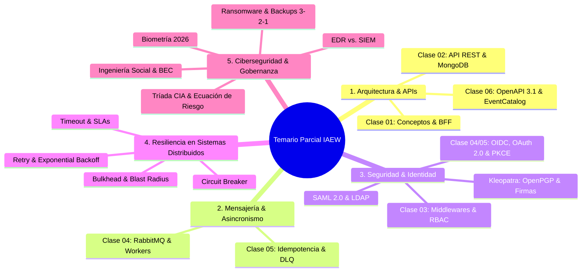

# 🎯 Temario de Repaso para el Parcial: Conceptos por Clases y Módulos

**Rama:** [[Hub_IAEW|IAEW]]  
**Materia:** Integración de Aplicaciones en Entorno Web (IAEW - UTN FRC)  
**Tags:** #materia/iaew #parcial #resumen #estudio #conceptos #checklist  
**Fecha:** 2026-10-15  

---

## 📌 Guía Rápida de Estudio: Estructura del Temario

---

## 📅 1. Clase 01: Fundamentos de Integración, APIs y Cloud
* [[2026-08-10_que_es_integracion_de_aplicaciones|¿Qué es la Integración de Aplicaciones?]]
  * Acoplamiento débil (*Loose Coupling*) vs. Acoplamiento fuerte.
  * Silos de información y sincronización entre sistemas heterogéneos.
* [[2026-08-10_apis_y_servicios_web|APIs y Servicios Web]]
  * Diferencias entre API Web, Servicio Web, REST y RPC.
  * Verbos HTTP (`GET`, `POST`, `PUT`, `PATCH`, `DELETE`) y códigos de estado (2xx, 4xx, 5xx).
* [[2026-08-10_patron_bff_backend_for_frontend|Patrón BFF (Backend For Frontend)]]
  * Adaptación de contratos por tipo de cliente (Mobile vs. Web vs. Smart TV).
  * Orquestación y agregación de llamadas para reducir latencia en redes móviles.
* [[2026-08-10_protocolo_websocket|Protocolo WebSocket]]
  * Comunicación Full-Duplex bidireccional sobre una sola conexión TCP.
  * Cuándo usar WebSocket vs. HTTP Polling vs. Server-Sent Events (SSE).
* [[2026-08-10_cloud_computing|Cloud Computing]]
  * Modelos de servicio: IaaS (*Infrastructure as a Service*), PaaS (*Platform as a Service*), SaaS (*Software as a Service*).
  * Responsabilidad compartida en la nube.
* [[2026-08-13_que_es_una_pipeline|¿Qué es una Pipeline de CI/CD?]]
  * Automatización de Build, Test y Deploy.

---

## 📅 2. Clase 02: API REST E-commerce, MongoDB y Persistencia
* [[2026-08-24_actividad_clase_02_ecommerce_api_rest_mongodb|Clase 02: API REST E-commerce con MongoDB]]
  * Modelado de datos documental con Mongoose.
  * Endpoints CRUD de Productos y Pedidos.
* [[2026-08-24_docker_mongodb_contenedores_y_persistencia|Docker, MongoDB y Persistencia]]
  * Contenedores con `docker-compose.yaml`.
  * Volúmenes persistentes y redes de contenedores.
* [[2026-08-24_preguntas_examen_clase_02_api_mongodb|Banco de Preguntas Clase 02]]
  * Validaciones de esquema, reglas de negocio y consistencia en bases NoSQL.

---

## 📅 3. Clase 03: Seguridad en APIs, Middlewares y Roles
* [[2026-08-31_actividad_clase_03_seguridad_api_middlewares_roles|Clase 03: Seguridad con Middlewares, Roles y API Keys]]
  * Cadena de middlewares en Express (`req`, `res`, `next`).
  * Autenticación basada en API Keys (cabecera `x-api-key`).
* [[2026-08-31_seguridad_apis_middlewares_rbac_ia|Seguridad en APIs: Middlewares, RBAC y Gobierno de IA]]
  * Control de acceso basado en roles: **RBAC** (*Role-Based Access Control*).
  * Diferencia entre autenticación (*"quién sos"*) y autorización (*"qué podés hacer"*).
  * Principio de Mínimo Privilegio (*Least Privilege*).
  * Mitigación de inyecciones y validación estricta de payloads.
* [[2026-08-13_gestion_apis_ataques_ddos|Gestión de APIs y Mitigación de Ataques DDoS]]
  * Rate Limiting, Throttling y Cuotas de consumo.

---

## 📅 4. Clase 04: Mensajería Asincrónica con RabbitMQ y Workers
* [[2026-09-07_actividad_clase_04_mensajeria_asincronica_rabbitmq_workers|Clase 04: Mensajería Asincrónica con RabbitMQ y Workers]]
  * Desacoplamiento temporal y espacial entre emisor y receptor.
  * Componentes del Broker: *Producers*, *Exchanges*, *Bindings*, *Queues*, *Consumers*.
  * Tipos de Exchanges: **Direct** (routing key exacta), **Fanout** (broadcast), **Topic** (patrones con comodines `*` y `#`).
  * Confirmaciones de entrega: `ack` (éxito), `nack` (rechazo).
* [[2026-09-03_flujo_password_deprecado_y_pkce_oauth2|Clase 04 (AIM): Flujo Password (Deprecado) y Fundamentos PKCE]]
  * Por qué está deprecado el flujo *Resource Owner Password Credentials* (ROPC).
  * Por qué no se deben manipular credenciales de usuario directamente en el cliente.

---

## 📅 5. Clase 05: Resiliencia de Integraciones, Idempotencia y DLQ
* [[2026-09-17_actividad_clase_05_resiliencia_idempotencia_retry_dlq|Clase 05: Resiliencia de Integraciones, Idempotencia y DLQ]]
  * **Idempotencia Técnica en HTTP:** Cabecera `Idempotency-Key` con índice `unique` y `sparse: true` en MongoDB.
  * **Idempotencia de Negocio en Mensajería:** Deduplicación mediante `eventId` en colección `EventoProcesado`.
  * **Topología de Retry con TTL en RabbitMQ:**
    * Cola Principal $\rightarrow$ Cola de Retry (`TTL=3000ms`) $\rightarrow$ Reingreso por Dead-Letter a Cola Principal.
    * Límite de reintentos (`MAX_RETRIES=3`).
  * **Dead Letter Queue (DLQ):** Destino final para mensajes venenosos (*poison messages*) o reintentos agotados.
  * **Peligro de `nack(requeue=true)`:** Por qué genera loops infinitos al 100% de CPU.
  * **Garantía At-Least-Once:** Reentrega de mensajes y deduplicación obligatoria en el consumidor.
* [[2026-09-17_instructivo_clase_05_resiliencia_paso_a_paso|Instructivo Paso a Paso: Laboratorio Clase 05]]

---

## 📅 6. Clase Especial: Criptografía Aplicada y Firmas con Kleopatra (OpenPGP)
* [[2026-09-25_actividad_cifrado_firma_kleopatra_openpgp|Cifrado y Firma Digital con Kleopatra (OpenPGP)]]
  * **Criptografía Simétrica vs. Asimétrica:** Secreto compartido vs. Par de Claves Pública y Privada.
  * **Uso de Claves:**
    * Para Cifrar: Clave **Pública del Receptor** (brinda **Confidencialidad**).
    * Para Descifrar: Clave **Privada del Receptor** (custodiada bajo *passphrase*).
    * Para Firmar: Clave **Privada del Emisor** (brinda **Autenticidad e Integridad / No Repudio**).
    * Para Verificar Firma: Clave **Pública del Emisor**.
  * **Firma + Cifrado Simultáneo:** Aporta Confidencialidad + Autenticidad + Integridad.
  * **Fingerprint (Huella Digital):** Hash único de 40 caracteres verificado por **canal fuera de banda** para evitar ataques *Man-in-the-Middle* (MitM).
  * **Tampering Test:** Por qué al modificar un solo carácter la firma digital queda inválida.

---

## 📅 7. Clase 06: Documentación de Contratos y Eventos
* [[2026-09-28_actividad_clase_06_documentacion_contratos_openapi_eventcatalog|Clase 06: Documentación de Contratos y Eventos (OpenAPI 3.1, JSON Schema y EventCatalog)]]
  * **OpenAPI 3.1.0:** Especificación formal de `POST /pedidos/{id}/confirmar`, headers (`Idempotency-Key`), seguridad OAuth 2.0 (`confirm:pedidos`) y los 7 estados HTTP (200, 400, 401, 403, 404, 409, 503).
  * **Swagger UI:** Montaje en Express en `/api-docs/` y `/api-docs/openapi.json`.
  * **JSON Schema (Draft 2020-12):** Contrato estricto para eventos RabbitMQ con `additionalProperties: false`, formatos `uuid` y `date-time`.
  * **Validación con AJV CLI:** Automatización de chequeo de esquemas en CI/CD.
  * **EventCatalog:** Catálogo de arquitectura orientada a eventos (EDA) vinculando Productor (`sends`), Contrato (`schemaPath`) y Consumidor (`receives`).
  * **C4 Model & ADRs:** Arquitectura documental (Contexto, Contenedores, Componentes y Decisiones Arquitectónicas).

---

## 🔑 8. Módulo de Seguridad, Identidad Federada y Protocolos SSO
* [[2026-08-13_analogia_oidc_oauth2|Analogía OIDC y OAuth2]]
  * OIDC = Identidad / Carnet de Conducir (Autenticación).
  * OAuth 2.0 = Llave Valet de Auto / Permisos (Autorización).
* [[2026-08-13_obtencion_y_tipos_de_tokens|Obtención y Tipos de Tokens]]
  * ID Token vs. Access Token vs. Refresh Token.
  * Estructura de un JWT (*Header, Payload, Signature*).
* [[2026-08-27_oidc_flujo_pkce_authorization_code|OpenID Connect (OIDC): Flujo Authorization Code con PKCE]]
  * Flujo seguro para SPAs y Apps Móviles (clientes públicos).
  * `code_verifier` y `code_challenge` (SHA-256) para mitigar intercepción del código de autorización.
* [[2026-09-17_oauth2_oidc_matriz_flujos_y_arquitectura|Matriz de Flujos OAuth 2.0 y OIDC: Cuándo Usar Cada Flujo]]
  * *Authorization Code + PKCE:* SPAs, Mobile, Web Apps interactivas con usuario presente.
  * *Client Credentials:* Comunicación Machine-to-Machine (M2M) entre microservicios sin usuario.
  * *Device Authorization Grant:* Smart TVs, consolas y herramientas CLI sin navegador.
  * *Password Grant (ROPC):* Deprecado / Inseguro.
* [[2026-09-17_validacion_local_jwks_vs_introspect|Validación Local con JWKS vs. Introspección (/introspect)]]
  * **Validación Local (JWKS):** Criptográfica asimétrica con clave pública en caché. Rápida, escalable, no sobrecarga al IdP, pero no detecta revocaciones inmediatas.
  * **Introspección (`/introspect`):** Llamada sincrónica HTTP al IdP por cada request. Detecta revocación instantánea, pero agrega latencia y crea un cuello de botella centralizado.
* [[2026-08-27_saml_autenticacion_federada_sso|Protocolo SAML 2.0 y Single Sign-On (SSO)]]
  * Identity Provider (IdP) vs. Service Provider (SP).
  * Assertions XML firmadas y redirecciones HTTP POST Binding.
* [[2026-08-27_ldap_protocolo_directorio_e_integracion_oidc|Protocolo LDAP y su Integración con OIDC]]
  * Árbol de información de directorio (DIT, `dn`, `ou`, `cn`).
  * Integración como *User Federation* en Keycloak para modernizar sistemas legados hacia OIDC.

---

## ⚡ 9. Módulo de Patrones de Resiliencia en Arquitecturas Distribuidas
* [[2026-10-15_patrones_de_resiliencia_retry_timeout_circuit_breaker_bulkhead|Patrones de Resiliencia: Retry, Timeout, Circuit Breaker y Bulkhead]]
  * **Retry (Reintento Controlado):**
    * Aplicable sólo a fallas transitorias (503, reinicios breves). Nunca en errores determinísticos (400, 401, 404).
    * Componentes: Máximo de intentos (2-3), **Exponential Backoff**, **Jitter** e **Idempotencia**.
    * Antipatrón: **Retry Storm / Thundering Herd**.
  * **Timeout (Presupuesto Temporal):**
    * Límite explícito a la espera. Protege hilos del servidor, conexiones y memoria (*Thread Starvation*).
    * Cálculo en base al SLA global de la transacción.
  * **Circuit Breaker (Interruptor de Circuito):**
    * Previene el **Efecto Dominó (*Cascading Failure*)**.
    * Estados: **Closed** (tráfico normal), **Open** (bloqueo total / Fail-Fast / Cooldown) y **Half-Open** (llamadas canary de prueba).
    * Diferencia con Timeout: Timeout decide sobre la llamada actual; Circuit Breaker sobre las llamadas futuras.
  * **Bulkhead (Compartimentos Estancos):**
    * Aislamiento de recursos (pools de hilos, colas, límites de concurrencia) por tipo de tarea.
    * Reducción del **Blast Radius** (radio de impacto de una falla).
  * **Casos Prácticos de Mercado Libre y Checkout:**
    * Fallback y degradación grácil (*Graceful Degradation*): ocultar recomendaciones sin bloquear la compra.

---

## 🛡️ 10. Módulo de Ciberseguridad General y Defensa en Profundidad
* [[2026-10-15_conceptos_generales_ciberseguridad_defensa_en_profundidad|Conceptos Generales de Ciberseguridad, Identidad y Defensa en Profundidad]]
  * **Tríada CIA:** Confidencialidad, Integridad y Disponibilidad.
  * **Ecuación de Riesgo:** Activo, Amenaza, Vulnerabilidad, Control e Incidente.
  * **Ingeniería Social:**
    * Señales: Urgencia artificial, autoridad, secreto.
    * Variantes: Phishing, Spear-phishing, Whaling, **BEC (*Business Email Compromise*)**, Vishing, Smishing.
    * **Verificación fuera de banda (*Out-of-Band*):** Protocolo estricto ante pedidos de cambio de CBU o transferencias urgentes.
    * Ataques Físicos y Modernos: Pretexting, Baiting (USB trampa), Quid Pro Quo, Tailgating, Deepfakes y clonación de voz.
  * **IAM y Autenticación Fuerte:**
    * Identificación vs. Autenticación vs. Autorización vs. Auditoría.
    * Fatiga de MFA (*Prompt Bombing*) y SIM Swapping.
    * **MFA resistente al phishing:** FIDO2 / WebAuthn y Passkeys con vinculación de origen (*Origin Binding*).
  * **Ransomware y Continuidad:**
    * Doble y triple extorsión. Por qué nunca pagar rescates.
    * **Regla 3-2-1:** Backups inmutables o fuera de línea (*Air-Gapped*) con **restauraciones probadas periódicamente**.
    * DLP (*Data Loss Prevention*) y Cifrado (en reposo y tránsito).
  * **Defensa en Profundidad (Zero Trust):**
    * **EDR (*Endpoint Detection and Response*):** Agente local en notebooks/servidores, analiza procesos/memoria y aísla equipos comprometidos.
    * **SIEM (*Security Information and Event Management*):** Plataforma central que ingiere y correlaciona logs de múltiples fuentes (IDP, red, EDR, servidores) para el equipo SOC.
  * **Ciclo de Respuesta a Incidentes (NIST SP 800-61):**
    * 1. Preparación $\rightarrow$ 2. Identificación $\rightarrow$ 3. Contención $\rightarrow$ 4. Erradicación $\rightarrow$ 5. Recuperación $\rightarrow$ 6. Lecciones Aprendidas.
  * **Biometría Moderna 2026:**
    * Biometría local (Secure Enclave) vs. SDK externo en la nube.
    * Ataques de presentación (*Spoofing*) y pruebas de vida (*Liveness Detection*).
    * **El Talón de Aquiles:** Canales de recuperación y soporte técnico vulnerables que permiten eludir la biometría o el MFA.

---

## ❓ 11. Bancos de Preguntas para el Parcial
* [[2026-08-24_preguntas_examen_clase_02_api_mongodb|Preguntas Clase 02: APIs y MongoDB]]
* [[2026-08-27_preguntas_examen_oidc_saml_ldap|Preguntas OIDC (PKCE), SAML 2.0 y LDAP]]
* [[2026-08-31_preguntas_examen_clase_03_seguridad_rbac|Preguntas Clase 03: Seguridad y Roles]]
* [[2026-09-25_actividad_cifrado_firma_kleopatra_openpgp|Preguntas de Kleopatra y Criptografía]]
* [[2026-10-15_patrones_de_resiliencia_retry_timeout_circuit_breaker_bulkhead#7. Banco de Preguntas de Autoevaluación y Examen Parcial|Preguntas de Patrones de Resiliencia]]
* [[2026-10-15_conceptos_generales_ciberseguridad_defensa_en_profundidad#9. Banco de Preguntas y Mini-Evaluaciones de Examen|Preguntas de Ciberseguridad y Defensa en Profundidad]]
