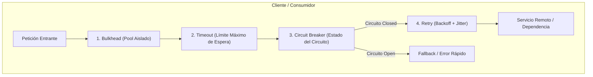
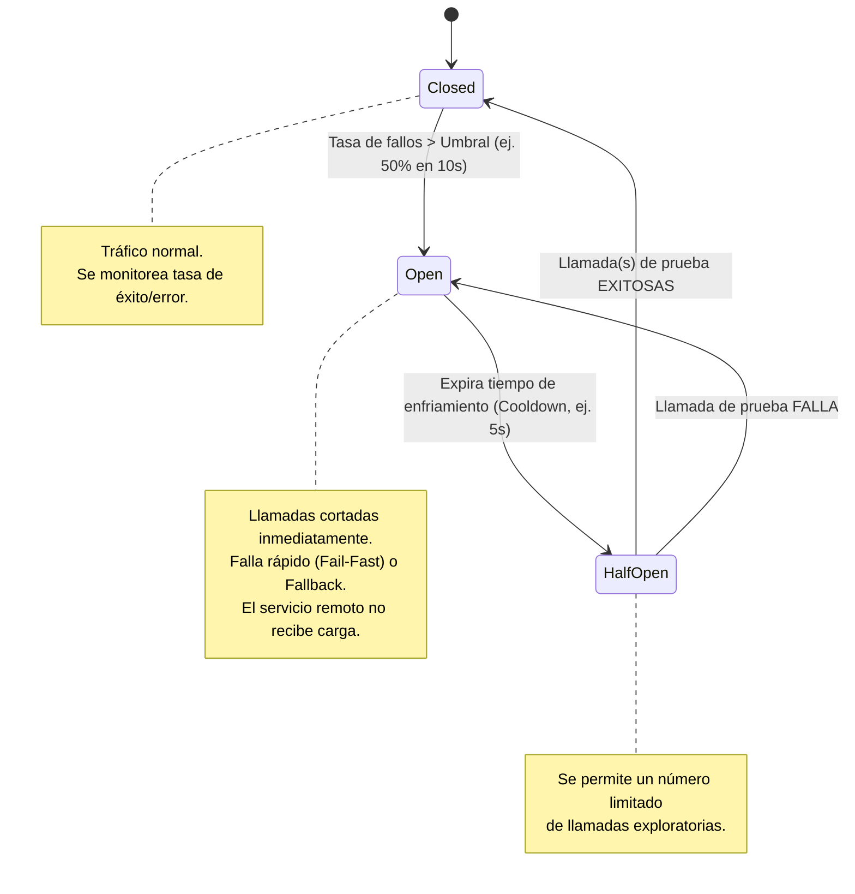

# Patrones de Resiliencia en Arquitecturas Distribuidas: Retry, Timeout, Circuit Breaker y Bulkhead

**Rama:** [[Hub_IAEW|IAEW]]  
**Tags:** #materia/iaew #arquitectura #resiliencia #patrones #microservicios #sistemas-distribuidos #parcial #apis  
**Fecha:** 2026-10-15  
**Categoría:** Arquitectura de Software y Resiliencia  

---

## 🧭 Índice de Contenidos

1. [[#1. El Problema Fundamental de los Sistemas Distribuidos|El Problema de los Sistemas Distribuidos]]
2. [[#2. Los Cuatro Patrones Fundamentales|Los Cuatro Patrones Fundamentales]]
   * [[#2.1. Retry (Reintento Controlado)|Retry]]
   * [[#2.2. Timeout (Presupuesto Temporal de Espera)|Timeout]]
   * [[#2.3. Circuit Breaker (Interruptor de Circuito)|Circuit Breaker]]
   * [[#2.4. Bulkhead (Compartimentos Estancos y Aislamiento de Recursos)|Bulkhead]]
3. [[#3. Combinación de Patrones y Arquitectura de Integración|Combinación de Patrones]]
4. [[#4. Cuadro Comparativo de Patrones|Cuadro Comparativo]]
5. [[#5. Antipatrones: Cuatro Formas de Empeorar una Falla|Antipatrones y Errores Peligrosos]]
6. [[#6. Ejercicios Prácticos Resueltos (Mercado Libre, Envíos y Pagos)|Ejercicios Prácticos Resueltos]]
7. [[#7. Banco de Preguntas de Autoevaluación y Examen Parcial|Banco de Preguntas para el Parcial]]

---

## 🧠 1. El Problema Fundamental de los Sistemas Distribuidos

En una arquitectura monolítica tradicional, las llamadas entre módulos se resuelven en memoria (nanosegundos, con garantías de ejecución o excepción determinística).  
En cambio, en **sistemas distribuidos y microservicios**:
* Las dependencias se comunican mediante redes no confiables (latencia variable, caídas transitorias, pérdida de paquetes).
* Las dependencias externas o internas pueden:
  1. **Fallar transitoriamente:** Reinicio de un pod, saturación momentánea de CPU (HTTP 503, conexión reseteada).
  2. **Responder con lentitud extrema:** Retención de hilos de ejecución (*threads*), sockets y memoria en el cliente llamador.
  3. **Provocar Efecto Dominó (*Cascading Failure*):** La saturación de un servicio secundario bloquea los hilos de los servicios principales hasta agotar el pool de la API Gateway, volteando todo el sistema.

> [!IMPORTANT]
> **Definición de Resiliencia:**  
> Un sistema resiliente **no es aquel que nunca falla**, sino aquel capaz de **absorber fallas locales, limitar su radio de impacto (*blast radius*) y continuar prestando servicios críticos de forma controlada y degradada**.

---

## 🛠️ 2. Los Cuatro Patrones Fundamentales



---

### 2.1. Retry (Reintento Controlado)

* **Propósito:** Volver a intentar una operación que falló, cuando existe una probabilidad razonable de que la falla sea **transitoria** y el servicio remoto se recupere solo.
* **Cuándo usar:**
  * Respuestas HTTP `503 Service Unavailable`, fallos momentáneos de socket, timeouts breves de red.
* **Cuándo NO usar jamás:**
  * **Errores determinísticos / permanentes:** HTTP `400 Bad Request` (payload inválido), `401 Unauthorized` / `403 Forbidden` (falta de permisos), `404 Not Found` (recurso inexistente) o `422 Unprocessable Entity`. Reintentar estos errores satura la red inútilmente porque siempre volverán a fallar.
* **Conceptos Mandatorios que Acompañan al Retry:**
  1. **Número Máximo de Intentos:** Típicamente 2 o 3 reintentos. ¡Nunca reintentos infinitos!
  2. **Exponential Backoff:** El intervalo de espera entre intentos debe crecer exponencialmente para darle tiempo al receptor de descongestionarse:
     $$\text{Espera} = \text{Base} \times 2^{\text{intento}}$$
     *(Ejemplo: Intento 1 $\rightarrow$ 200 ms; Intento 2 $\rightarrow$ 400 ms; Intento 3 $\rightarrow$ 800 ms).*
  3. **Jitter (Variación Aleatoria):** Si 10.000 clientes fallan al mismo tiempo y todos esperan exactamente 200 ms, reintentarán en el mismo milisegundo provocando una avalancha (**Thundering Herd** / **Retry Storm**). El *jitter* añade un factor aleatorio (ej. $200\text{ ms} \pm 35\text{ ms}$) para dispersar el tráfico.
  4. **Idempotencia:** Si la llamada a reintentar tiene efectos colaterales (ej. crear un pago, transferir dinero, descontar stock), el servidor **debe implementar idempotencia** (ej. header `Idempotency-Key`). Si el primer intento procesó el cobro pero la respuesta HTTP se perdió por timeout de red, un reintento ciego cobraría dos veces.

---

### 2.2. Timeout (Presupuesto Temporal de Espera)

* **Propósito:** Poner un límite temporal explícito e innegociable a la espera de una respuesta. Al cumplirse el plazo, se cancela la llamada, se liberan los hilos y conexiones bloqueados, y se ejecuta un camino alternativo (*fallback*).
* **Recursos que Protege:** Hilos de ejecución del servidor web (Tomcat, Express, Kestrel), conexiones del pool HTTP, memoria y el tiempo de respuesta percibido por el usuario final.
* **Cómo Definir el Timeout:**
  * No debe elegirse al azar. Se calcula a partir del **presupuesto de tiempo de la transacción (SLA/SLO)**.
  * Si el checkout total del usuario debe responder en $\le 3\text{ segundos}$, ninguna consulta interna a cotizaciones de envío puede tener un timeout de 10 segundos.

---

### 2.3. Circuit Breaker (Interruptor de Circuito)

* **Propósito:** Evitar seguir enviando solicitudes a una dependencia que ha demostrado estar caída o severamente degradada, permitiéndole recuperarse y evitando que el cliente agote sus propios recursos (**falla rápida / Fail-Fast**).



#### Los Tres Estados:
1. **Closed (Cerrado):** Estado normal. Las peticiones fluyen hacia la dependencia. El Circuit Breaker contabiliza éxitos y fallos en una ventana de tiempo.
2. **Open (Abierto):** Se alcanzó el umbral de fallos (ej. 5 fallos consecutivos o 50% de error en 10s). Las solicitudes **no viajan a la red**; se rechazan de inmediato devolviendo un error rápido o ejecutando un *fallback*. Se activa un temporizador de enfriamiento (*cooldown* o *sleep window*, ej. 5 a 30 segundos).
3. **Half-Open (Semi-Abierto):** Al terminar el cooldown, el circuito permite pasar una pequeña cantidad de solicitudes de prueba (canary requests). Si responden con éxito, asume que la dependencia se recuperó y vuelve a **Closed**. Si fallan, regresa a **Open** reiniciando el cooldown.

> [!NOTE]
> **Diferencia Clave entre Timeout y Circuit Breaker:**
> * El **Timeout** decide cuándo abortar una solicitud individual que está demorando.
> * El **Circuit Breaker** decide si tiene sentido emitir solicitudes futuras basándose en el historial de fallos recientes.

---

### 2.4. Bulkhead (Compartimentos Estancos)

* **Origen Náutico:** Proviene de los mamparos estancos de los barcos. Si el casco se perfora y entra agua en un compartimento, este se aísla para evitar que todo el barco se hunda.
* **En Sistemas:** Consiste en **separar y aislar recursos** (pools de conexiones, hilos de ejecución, instancias, límites de concurrencia o colas) por tipo de carga o criticidad, de modo que la saturación de un módulo pesado no consuma la capacidad reservada para operaciones esenciales.
* **Blast Radius (Radio de Impacto):** Es el área de afectación cuando ocurre un fallo. Bulkhead busca minimizar el blast radius.
* **No requiere necesariamente microservicios separados:** Puede implementarse dentro del mismo proceso asignando pools de hilos diferenciados:
  * Pool A (2 hilos): Generación de reportes masivos y exportación de PDFs (proceso lento).
  * Pool B (10 hilos): Autenticación (Login) y Checkout de compras (proceso crítico en línea).

---

## 🧩 3. Combinación de Patrones y Arquitectura de Integración

En arquitecturas empresariales (como Mercado Libre, Mercado Pago o Netflix), los patrones no compiten entre sí, sino que **se encadenan en capas**:

```text
Solicitud de Checkout
  │
  ▼
[BULKHEAD] ──> Pool de hilos reservado exclusivamente para Checkout
  │
  ▼
[CIRCUIT BREAKER] ──> ¿La dependencia remota está sana?
  │                  Si está OPEN ──> Fallback inmediato (Fail-Fast)
  │                  Si está CLOSED ──> Pasa
  ▼
[RETRY CON BACKOFF + JITTER] ──> ¿Hubo fallo transitorio (503 / reset)?
  │                             Reintenta hasta 2 veces con espera creciente
  ▼
[TIMEOUT] ──> Límite de 800 ms por intento (Presupuesto total controlado)
  │
  ▼
Servicio Externo (ej. Cotización de Envíos)
```

### Ejemplo Integral: Checkout de un Marketplace

| Dependencia | Criticidad | Patrones Recomendados | Comportamiento y Degradación Grácil |
| :--- | :--- | :--- | :--- |
| **Servicio de Stock** | Crítica | **Timeout + Circuit Breaker** | Si demora más de 800 ms se corta. Si falla sostenidamente, el circuito se abre y el checkout se detiene de forma limpia informando falta de disponibilidad momentánea. |
| **Cálculo de Envío** | Media | **Timeout + Retry limitado + Fallback** | Timeout de 2s. Si falla, reintento con backoff. Si expira, fallback: ofrecer retiro en sucursal o aplicar tarifa plana estimada. |
| **Cobro / Pago** | Máxima | **Timeout + Idempotency-Key + Retry** | Reintento permitido **únicamente** si se envía la misma clave de idempotencia (`Idempotency-Key`) para no duplicar cargos financieros. |
| **Motor de Recomendaciones** | Baja / Opcional | **Bulkhead + Timeout muy corto (300 ms)** | Si demora o falla, se omite el carrusel de productos recomendados. **Nunca se bloquea la compra del usuario por una falla en recomendaciones.** |
| **Notificaciones por Email** | Asincrónica | **Cola RabbitMQ + Worker desacoplado** | La confirmación de compra responde 200 OK de inmediato. El envío del mail se reintenta en segundo plano mediante colas con Dead Letter Queue (DLQ). |

---

## 📊 4. Cuadro Comparativo de Patrones

| Patrón | Pregunta que Responde | Problema Típico que Resuelve | Riesgo si se Configura Mal |
| :--- | :--- | :--- | :--- |
| **Retry** | *¿Conviene volver a intentar la operación?* | Falla transitoria de red o reinicio breve de servicio. | **Retry Storm:** Multiplica el tráfico y derriba un servidor convaleciente. Cargos duplicados sin idempotencia. |
| **Timeout** | *¿Cuánto tiempo como máximo estoy dispuesto a esperar?* | Dependencia lenta, colgada o pérdida silenciosa de paquetes. | **Timeout demasiado corto:** Corta operaciones legítimas que estaban a punto de terminar. **Muy largo:** Hilos retenidos. |
| **Circuit Breaker** | *¿Tiene sentido seguir llamando a este servicio?* | Fallas consecutivas sostenidas y prevención del efecto dominó. | **Circuito hipersensible:** Se abre por fallos aislados normales. **Muy tolerante:** Permite la caída en cascada. |
| **Bulkhead** | *¿Cómo evito que la saturación de una función consuma todo el sistema?* | Agotamiento general de recursos por culpa de procesos pesados o secundarios. | **Mala división de capacidad:** Hilos ociosos en un pool mientras otro pool prioritario se queda corto. |

---

## ⚠️ 5. Antipatrones: Cuatro Formas de Empeorar una Falla

1. **Retry Infinito o Sin Backoff (Retry Storm):**
   * Configurar 20 reintentos seguidos a intervalos de 0 ms cuando un servicio está al 100% de CPU multiplica la carga instantáneamente, garantizando que el servicio colapse por completo.
2. **Timeouts Inexistentes o Excesivos:**
   * Dejar el timeout por defecto de sockets (que suele ser infinito o de varios minutos). Ante una lentitud del backend, cada petición retiene un hilo de Express/Tomcat hasta que el servidor rechaza nuevas conexiones (`Thread Starvation`).
3. **Circuit Breaker con Umbral Inadecuado:**
   * Abrirse tras un único fallo transitorio (afectando la disponibilidad sin motivo) o exigir 500 fallos antes de abrirse (permitiendo que el efecto dominó arrase antes de activarse).
4. **Pool Único Compartido (Falta de Bulkhead):**
   * Ejecutar la exportación de reportes de 10 minutos y el endpoint de Login en el mismo pool de 10 workers. Un usuario que pide 10 reportes deja a toda la empresa sin poder iniciar sesión.

---

## 📝 6. Ejercicios Prácticos Resueltos (Mercado Libre, Envíos y Pagos)

### Ejercicio 1: Consulta de Stock con 503 Intermitente
* **Escenario:** Mercado Libre consulta stock de un producto. Devuelve 503 de manera intermitente durante 2 segundos. La operación es de sólo lectura (`GET`).
* **Resolución Paso a Paso:**
  1. Identificar si el error es transitorio: un 503 intermitente suele ser un reinicio de réplica o saturación breve.
  2. Verificar idempotencia: al ser de sólo lectura (`GET`), repetirla no genera efectos secundarios indeseados.
  3. **Solución:** Aplicar **Retry con Exponential Backoff y Jitter** (máximo 2 a 3 reintentos: 100ms, 250ms), acompañado de un **Timeout estricto** por intento (ej. 500 ms).

### Ejercicio 2: Cotización de Envío que Demora 12 Segundos
* **Escenario:** Mercado Envíos calcula el costo de entrega. La dependencia externa tarda a veces 12 segundos, pero el checkout del usuario no puede esperar más de 3 segundos.
* **Resolución Paso a Paso:**
  1. Identificar el presupuesto temporal de la transacción: 3 segundos.
  2. **Solución:** Configurar un **Timeout de 2.5 segundos** en la llamada al cotizador.
  3. Definir la **Estrategia de Fallback:** Al dispararse el timeout, se liberan recursos y se aplica una degradación grácil: se muestra una tarifa plana estimada o se informa al usuario *"Costo de envío a coordinar con el vendedor"*, permitiendo que el checkout avance sin trabar la compra.

### Ejercicio 3: Servicio de Disponibilidad Caído Durante 5 Minutos
* **Escenario:** Un servicio externo lleva 5 minutos respondiendo con error. Los consumidores tienen configurado Timeout de 2 segundos y siguen enviando miles de solicitudes por minuto.
* **Resolución Paso a Paso:**
  1. Diagnóstico: El Timeout evita que cada solicitud espere indefinidamente, pero **no evita que sigan saliendo peticiones a la red**, manteniendo saturado al proveedor y consumiendo sockets locales.
  2. **Solución:** Implementar **Circuit Breaker**. Al superar el umbral de fallos en Closed, pasa a **Open** e interrumpe las llamadas en el origen (Fail-Fast inmediato). Tras un cooldown (ej. 30 segundos), pasará a **Half-Open** para probar si el proveedor se recuperó.

### Ejercicio 4: Generación Masiva de Imágenes vs. Login y Checkout
* **Escenario:** Los vendedores suben imágenes de productos y el servicio genera miniaturas pesadas. Ese procesamiento consume el 100% de los workers, provocando caídas en el Login y Checkout.
* **Resolución Paso a Paso:**
  1. Diagnóstico: El fallo de un módulo batch está inundando el sistema entero debido a la falta de aislamiento (Blast Radius total).
  2. **Solución:** Implementar **Bulkhead**. Separar los recursos:
     * Pool de Workers Batch (ej. 2 workers con prioridad baja y cola desacoplada) para procesamiento de imágenes.
     * Pool de Workers Críticos (ej. 8 workers con memoria y CPU garantizadas) para Login, Búsqueda y Checkout.

### Ejercicio 5: Creación de Pago en Mercado Pago ante Timeout
* **Escenario:** Se envía un cobro de tarjeta a Mercado Pago y la llamada da Timeout. Se quiere aplicar Retry.
* **Resolución Paso a Paso:**
  1. Peligro: El Timeout significa que el cliente dejó de esperar la respuesta, pero el servidor de pagos pudo haber procesado el débito exitosamente antes de que se cortara la conexión.
  2. **Condición Obligatoria:** **Idempotencia**.
  3. **Solución:** Solo se puede reintentar si el cliente envía un identificador único de intención (`Idempotency-Key: uuid`). El servidor de Mercado Pago reconocerá la clave y, si el cargo ya se había realizado, devolverá el resultado anterior en lugar de cobrar dos veces.

### Ejercicio 6: Retry Storm con 20 Intentos Inmediatos
* **Escenario:** Un servicio tiene configurado 20 reintentos sin pausa entre llamadas.
* **Problema:** **Retry Storm**. Ante una lentitud del backend, 1.000 usuarios generan 20.000 peticiones en segundos, colapsando el servidor por completo.
* **Corrección Profesional:**
  * Reducir a máximo 2 o 3 reintentos.
  * Incorporar Exponential Backoff (ej. 200ms, 400ms, 800ms).
  * Agregar Jitter aleatorio.
  * Añadir Circuit Breaker para suspender reintentos si el proveedor no responde.

---

## ❓ 7. Banco de Preguntas de Autoevaluación y Examen Parcial

### 1. ¿Cuál es la diferencia conceptual fundamental entre Retry y Circuit Breaker?
> **Respuesta:** **Retry** asume que la falla es momentánea y **repite la llamada** para intentar tener éxito. **Circuit Breaker** asume que la falla es sostenida y **bloquea nuevas llamadas** hacia la dependencia para no empeorar su estado y proteger al cliente.

### 2. ¿Por qué un Retry sin backoff empeora una caída del sistema?
> **Respuesta:** Porque bombardea a un servicio que ya está saturado o reiniciándose con ráfagas continuas de tráfico sin darle tiempo a vaciar sus colas o estabilizar su CPU (**Retry Storm**).

### 3. ¿Qué significa que una operación sea idempotente y por qué es obligatoria en operaciones de escritura con Retry?
> **Respuesta:** Significa que ejecutar la operación múltiples veces con los mismos parámetros produce exactamente el mismo resultado y estado en el sistema que ejecutarla una sola vez. Es obligatoria en operaciones de escritura (como transferencias o compras) porque si el reintento se ejecuta tras un timeout de red, evita duplicar transacciones.

### 4. ¿Qué diferencia de comportamiento existe entre el estado Open y Half-Open en un Circuit Breaker?
> **Respuesta:** En **Open**, el circuito rechaza el 100% de las llamadas en el origen (Fail-Fast inmediato) sin enviarlas a la red. En **Half-Open**, permite pasar un número muy reducido de llamadas exploratorias (canary) para verificar si la dependencia remota ya se recuperó.

### 5. ¿Qué recursos críticos del servidor protege la configuración de un Timeout?
> **Respuesta:** Hilos de ejecución (*threads* o *event loop worker threads*), sockets de red, descriptores de archivo, conexiones activas del pool de base de datos/HTTP y memoria RAM.

### 6. ¿Qué se entiende por "Blast Radius" (Radio de Impacto) y qué patrón lo reduce directamente?
> **Respuesta:** El *blast radius* es el porcentaje de usuarios, módulos o sistemas afectados cuando ocurre una falla. El patrón **Bulkhead** lo reduce directamente al aislar los recursos en compartimentos estancos independientes.

### 7. ¿Por qué el patrón Bulkhead no requiere necesariamente desplegar microservicios separados?
> **Respuesta:** Porque puede implementarse a nivel de software dentro de una misma aplicación o proceso, configurando diferentes *Thread Pools*, *Connection Pools*, semáforos de concurrencia o colas de mensajes separadas por tipo de tarea.

### 8. ¿Por qué Timeout y Circuit Breaker son complementarios y no equivalentes?
> **Respuesta:** Porque el Timeout actúa sobre la **duración de una solicitud individual en curso**, mientras que el Circuit Breaker evalúa la **salud histórica global de la dependencia** para decidir si conviene o no autorizar el envío de solicitudes futuras.

---

*Conexiones conceptuales:*
- [[2026-09-17_actividad_clase_05_resiliencia_idempotencia_retry_dlq|Clase 05: Resiliencia de Integraciones, Idempotencia y DLQ]]
- [[2026-09-17_instructivo_clase_05_resiliencia_paso_a_paso|Instructivo Paso a Paso: Laboratorio de Resiliencia]]
- [[2026-08-10_patron_bff_backend_for_frontend|Patrón BFF y Gestión de Concurrencia]]
- [[2026-08-13_gestion_apis_ataques_ddos|Gestión de APIs y Mitigación de DDoS]]
